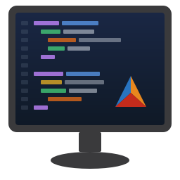

<p align="center">
  
</p>

<h1 align="center">Clarion Assistant</h1>

<p align="center">
  <strong>AI-powered coding assistant for the Clarion IDE</strong><br>
  Embeds Claude Code directly into your Clarion development workflow
</p>

<p align="center">
  <a href="https://github.com/ClarionLive/ClarionAssistant/releases/latest"></a>
  
  
</p>

<p align="center">
  <em>An independent community project &mdash; not a SoftVelocity product.</em><br>
  <a href="docs/HISTORY.md">History, stats &amp; contributors</a>
</p>

---

## What is Clarion Assistant?

Clarion Assistant is an IDE addin that brings AI-powered code intelligence to [Clarion](https://softvelocity.com) developers. It runs as a docked terminal pane inside the Clarion IDE, giving you a conversational coding assistant that understands your entire codebase.

Ask it to write Clarion code, explain procedures, refactor classes, build COM controls, convert Clarion apps to C#, or navigate your solution &mdash; all without leaving the IDE.

### Key Capabilities

- **Write and edit Clarion code** directly in the IDE editor
- **Multi-tab terminal** &mdash; multiple Claude Code sessions with independent workspaces
- **Language Server (LSP)** &mdash; real-time code intelligence with go-to-definition, find references, hover info, diagnostics, and rename support
- **CodeGraph** &mdash; solution-wide code intelligence via SQL queries over every symbol, relationship, and call chain
- **DocGraph** &mdash; instant search across 14,000+ indexed documentation chunks (Clarion core, CapeSoft, Icetips, and more)
- **SchemaGraph** &mdash; database schema intelligence from Clarion dictionaries, SQL Server, SQLite, and PostgreSQL
- **Source Control** &mdash; GitHub and Bitbucket integration with per-solution repo linking
- **Build tools** &mdash; generate source for solutions or individual apps (generate only, no compile), or build C# COM controls, without leaving the chat
- **Class intelligence** &mdash; parse CLASS definitions, sync .inc/.clw, generate method stubs
- **Application tree** &mdash; open .app files, list procedures, navigate the embeditor
- **Monaco source editor** &mdash; the default editor for Clarion `.clw`/`.inc` source: syntax highlighting, folding, F12/Ctrl+Click go-to-definition, inline diagnostics, and completion (toggleable under Options &rarr; Clarion Assistant &rarr; Editor Surfaces)
- **Smart Formatter (Ctrl+I)** &mdash; reformats Clarion code with structure indentation and aligned declarations; configurable
- **CA Embeditor** &mdash; use Clarion's own **Embeditor Source** (right-click a procedure, or the Views toolbar button) and a fast Monaco/WebView2 editor overlays the native embeditor automatically; edits save straight back with Clarion-native Save &amp; Exit
- **Embed navigation (Ctrl+J / Ctrl+B)** &mdash; jump to the next/previous *filled* embed, the same keys the native Clarion embeditor uses (#185); the toolbar arrows and an unfiltered walk over every embed are there too, and all of it is rebindable
- **Code Snippets (Ctrl+Shift+J)** &mdash; classic Clarion template-picker parity: insert reusable code with tab-stops and a `${SELECTED}` placeholder, managed from Settings &rarr; Snippets
- **CA Explorer** &mdash; docked pad showing the CA Embeditor's open procedure: its Local, Module &amp; Global Data, Declared Tables, Other Files, and their Keys, Columns, and Relations; drag a field to the editor or Window designer, copy/paste variables native-style, and a Cheat Sheet tab of editor shortcuts
- **Evaluate Code** &mdash; interactive code review for entire apps, procedures, open files, or selected code
- **CA Find & Replace** &mdash; dockable Find pad or classic in-editor overlay (your pick), Find-All with results in their own editor tab, and one shared history across every CA surface
- **Document Structure** &mdash; fly-out outline of the current buffer with symbol icons, Class &#9656; Methods regrouping, and filtering; click to navigate
- **Diff viewer** &mdash; Monaco-based side-by-side diffs with syntax highlighting, live-buffer diffing, and a current-line comparison panel
- **Knowledge system** &mdash; persistent cross-session memory for decisions, patterns, and gotchas
- **Zoom persistence** &mdash; Ctrl+mousewheel zoom is saved and restored across sessions

---

## What's New (Unreleased)

<!-- Entries for the next release go here, in the same shape as the release blocks below. -->

<!-- release-docs: covered=skills -->
### The StringTheory skill is rewritten and checked against the StringTheory source, by geircodes ([PR #282](https://github.com/ClarionLive/ClarionAssistant/pull/282))

The bundled `stringtheory` skill told Claude to use `FromBlob` / `ToBlob` on a MEMO field. Those methods take a `*BLOB`, so that code does not compile; a MEMO is a plain string and is assigned like one. The `jfiles` skill repeated the advice and is corrected too. The skill also listed `Encrypt` / `Decrypt` methods that StringTheory does not have.

geircodes ([@geircodes](https://github.com/geircodes)) rewrote the skill with every rule checked against `StringTheory.clw` / `.inc` 3.90, and added the silent failures an agent hits when writing StringTheory code: arguments used at their full declared size unless clipped, the three return conventions (`TRUE`/`FALSE`, `st:ok` which is zero, `st:notFound`), the `base64` and `encoding` properties that `SetValue` and `Append` leave behind, the US-ASCII default code page, `UrlEncode(Text)` binding to the flags overload and encoding the object's own value, overlapping `Count` matches, `Equals` clipping, `Random` / `MakeGuid` being predictable, and who owns the memory returned by `GetValuePtr`, `ToCstring`, `Utf16To8` and `_StealValue`. The skill's solution-specific example is replaced by a generic one. We read the rules against the StringTheory 3.70 source as well: the ones that need a newer library (a negative end in `Slice`, the `Normalize` property, `st:min`, `st:CSVDecode`) now say which version added them, and `Equals(StringTheory)` is noted as always comparing exact lengths.

<!-- release-docs: covered=hover -->
### Hovering a procedure declared in the file you are editing shows the language server's card, by geircodes ([PR #286](https://github.com/ClarionLive/ClarionAssistant/pull/286))

6.2 made hover ask the language server for parameters, locals, routines and procedures found through the index. One case still showed only Clarion Assistant's quick card: a procedure the file itself prototypes or implements (`InventoryDetailToolBar PROCEDURE` in its own module, a procedure in the module's MAP, or one in a procedure's local MAP). That card names the file but no line, and it cannot see a prototype the file does not hold, so a procedure implemented in a MEMBER module and prototyped in a file INCLUDEd by the MAP showed its implementation line as the declaration. Those hovers now show the language server's card, which links the prototype and then the implementation (`protos.inc:1` → `mod.clw:5`). The quick card still appears when the server has nothing, is not running, or does not answer within 300 ms. A member of a CLASS declared in the file keeps both cards, as before, since the server may know inherited members.

### Thanks

- **[@geircodes](https://github.com/geircodes)** &mdash; [PR #282](https://github.com/ClarionLive/ClarionAssistant/pull/282): the StringTheory skill rewrite, every rule read against the library source; [PR #286](https://github.com/ClarionLive/ClarionAssistant/pull/286): the last hover card that skipped the language server, procedures declared in the file, now asks it too, with a 10,000-hover measurement behind the change.

## What's New in v6.2

6.2 lets MultiTerminal, VS Code and any other client that loads the clarion-assistant plugin use the Clarion IDE tools (embeds, the editor, the app tree) while Clarion is open on the same solution, moves the bundled language server to v1.0.9 with clickable attribute chips on controls, window headers and FILE declarations, ends hover cards in a bar with their location links and Open Structure Designer, and fixes CodeGraph's `.red` `{include %REDNAME%}` and `INCLUDE()` handling. It also adds a shared plugin location for people with several Claude profiles. Full notes: **[docs/releases/v6.2.0.md](docs/releases/v6.2.0.md)**.

### Upgrade notes

Do these once after installing this release:

- **Update Clarion Assistant in the Clarion you open your solution in.** The IDE tools below reach only a Clarion running Clarion Assistant 6.2 or later; an older one is named in the error, with the folder to update.
- **The first CodeGraph index after updating is a full rebuild**, which runs by itself: the indexer now reads `INCLUDE()` differently, so an index made by 6.1 is upgraded (feature level 2 to 3), and the header reads **Rebuilding index...** while it runs. Re-index any solution whose `.red` ends `{include %BIN%\%REDNAME%}` ([#278](https://github.com/ClarionLive/ClarionAssistant/issues/278)) to pick up the ABC and third-party classes it was missing; that rebuild does it.
- **The first language-server start after updating is slower once**: v1.0.9 rebuilds its saved caches.
- **Close Claude Code and MultiTerminal sessions before running the installer**, or run `/mcp` to reconnect in each one afterwards: a running plugin server holds files in the install folder.

<!-- release-docs: covered=ide-proxy,mcp-server,ide-tools -->
### MultiTerminal, VS Code and other plugin clients can use the IDE tools while Clarion is open

A Claude session outside a CA tab (a MultiTerminal or VS Code terminal with the clarion-assistant plugin, or any other client that loads it) used to get only the tools that work without the IDE: documentation, CodeGraph, LSP, schema, file and search. It now gets the IDE tools too (opening and editing embed points, driving the editor, reading the app tree and dictionary, building), the same ones a CA tab has, whenever Clarion is open on the same solution as the client. The plugin's server sends each call to that Clarion and returns its answer, so these tools behave as they do in a CA tab, inside the same file-access rules.

- **The plugin's server starts without Clarion.** With Clarion closed, or open on a different solution, an IDE tool says so and tells you to open the solution in Clarion; every other tool works as before. A Clarion that has a different solution open is never used.
- **One Clarion per solution.** If two Clarions have the same solution open, an IDE tool asks you to close one, or to set `CLARION_IDE_PID` to the one you mean, rather than guess which one to change.
- **No CA tab needed.** Clarion serves these tools whether or not a Clarion Assistant pane is open. A CA tab itself is unchanged: its tools are not listed twice.
- **`--capabilities` reports `ide-proxy=1`** for a server that can do this.
- **The same file-access rules, for every path an IDE tool takes.** `open_file`, `export_txa`, `import_txa`, `export_dctx`, `import_dctx`, `show_diff`'s files and `build_app` / `generate_source`'s `app_path` / `project_path` are now checked like `read_file` / `write_file`, **in a CA tab too**: a network (`\\server\share`) path is refused before Clarion touches it, and so is a path outside the solution, the Clarion folders and your `Mcp.AllowedRoots`. An `export_dctx` with no path writes beside the dictionary only when that folder is inside the solution; otherwise pass a path in the solution. `build_app` / `generate_source` need only read access to the app: ClarionCL writes that app's own generated modules, in its own folder, as Clarion's Generate does.
- **Editing and saving are checked against the file in the editor, in a CA tab too.** `insert_text_at_cursor`, `replace_text`, `replace_range`, `delete_range`, `toggle_comment`, `undo`, `redo` and `save_file` are refused, with nothing changed, when the active file is one the tools may not write: for example `.vscode\tasks.json`, `.git\config`, `CLAUDE.md`, `.mcp.json`, a `.sln` or `.red`, or a file under the Clarion folders, which are read-only to the tools. **This is a deliberate change:** a CA Editor tab on a Clarion template (`.tpl`/`.tpw` under the Clarion root) can no longer be edited through these tools; edit it yourself, or with your assistant's own Edit tool, which asks you first. Generated `.clw` modules in the solution, and embed code in the embeditor (native or CA), are edited as before; `close_file` is not affected. The save before `build_app` / `build_solution` / `generate_source` skips a CA Editor tab on such a file and names it in the result; the tab keeps its unsaved edits.
- **Some diagnostics stay inside the IDE.** `execute_command` and `dump_object_api` are not offered outside a CA tab, and there `inspect_ide` takes only `active_view`, `editor_text`, `all_windows`, `all_pads` and `app_details`.
- **Clarion checks again before it runs anything.** If Clarion has switched to another solution since the plugin's server picked it, the call says so and nothing is run. One IDE tool runs at a time across all clients: a call that arrives while another client's tool is running waits up to 10 s, then says Clarion is busy and that nothing was run.
- **You can see changes made from outside.** Each editing, saving, importing or generating call from a plugin client writes `[ide-callback] <tool> from plugin client` to `monaco-spike.log` and shows a note in Clarion's status bar.
- **Known limitation: one call at a time per client.** The plugin's server handles one request at a time, so a long IDE call (an embeditor open, a build) holds up that client's next call until it finishes, and cancelling the call in the client does not stop it in Clarion. Serving calls in parallel would let two calls from the same client reach Clarion out of order, so it was left out.

<!-- release-docs: covered=red,index -->
### A local `.red` that ends `{include %BIN%\%REDNAME%}` keeps the default search paths, by geircodes ([#278](https://github.com/ClarionLive/ClarionAssistant/issues/278), [PR #276](https://github.com/ClarionLive/ClarionAssistant/pull/276))

`%REDNAME%` is a macro Clarion defines itself: the name of the version's redirection file, such as `Clarion100.red`. Clarion Assistant did not define it, so the line the IDE writes at the end of a new solution's `.red` was skipped, and every path of the default `.red` (`libsrc\win`, `Accessory\libsrc\win` and the rest) was missing. CodeGraph then indexed no ABC or third-party class, reported thousands of unresolved files, and `resolve_red_path` could not find `ABUTIL.INC` while `get_red_search_paths` could. The macro is now defined, so both tools and the index follow the include. The index log also names each `{include}` the `.red` could not follow, right after the redirection file it used, instead of leaving the cause in `get_solution_info` alone. The line says why: a file that does not exist (often an undefined `%MACRO%`), one nested too deep, or one that could not be read is a WARNING, because its search paths are missing. An `{include}` of a file already loaded (a `.red` that includes itself) is a harmless note, not a warning. A project's own version-named `.red` is reported the same way, with the project's name. Re-index after updating. Thanks to [@msarson](https://github.com/msarson) for the report and [@geircodes](https://github.com/geircodes) for the fix.

<!-- release-docs: covered=codegraph,index -->
### CodeGraph reads `INCLUDE()` the way the compiler does, by geircodes ([#271](https://github.com/ClarionLive/ClarionAssistant/issues/271), [PR #275](https://github.com/ClarionLive/ClarionAssistant/pull/275), [PR #268](https://github.com/ClarionLive/ClarionAssistant/pull/268))

- **A commented-out INCLUDE is not followed.** `! INCLUDE('Old.inc')` used to count as a real include: a bogus "did not resolve" warning when the file was gone, and code that is never compiled in the index when it was still there.
- **An INCLUDE inside a `COMPILE('t', expr)` or `OMIT('t', expr)` block is not counted as missing.** When it does not resolve and no unconditional route leads to it, it is recorded as `unresolved_conditional`, listed in the coverage summary and kept out of the warning: it is usually a file only another build of the same shared source has on its paths.
  - **The include guard is not a condition.** Nearly every LibSrc `.inc` wraps itself in `OMIT('_EndOfInclude_',_UtilitiesPresent_)` with `_UtilitiesPresent_ EQUATE(1)` right after it (`ABUTIL.INC`). That block compiles on the file's first read, so a missing INCLUDE inside it is still reported as missing.
  - **An `.inc` the `.cwproj` lists** is judged by how it is INCLUDEd, like any other: what it INCLUDEs counts as missing when the `.inc` itself is INCLUDEd unconditionally.
  - **A `|` inside a comment is not a line continuation.** `! note |` no longer swallows the INCLUDE on the next line. A conditional block whose terminator sits inside an `OMIT('t')` block now ends there, so what follows it is not treated as conditional.
- **The warning names the files.** `2 INCLUDE()d .inc file(s) did not resolve: Missing.inc (App.clw:5), ...` names up to ten, each with the file and line that INCLUDEs it, and the index log names every one. INCLUDEs in the PROGRAM file's global data are now stored too, so that file can be named.
- **A data declaration labelled `Itemize`** (`Itemize LONG`, `Itemize EQUATE(3)`) no longer opens an ITEMIZE block that swallowed every declaration after it.
- **A `.red` search folder that does not exist** (an old `%ROOT%\convsrc` line, for one) reads as harmless in the index log: it never affected the index.

The first index after updating runs a full one by itself. Thanks to [@KevinErskine](https://github.com/KevinErskine) and [@msarson](https://github.com/msarson) for the reports and [@geircodes](https://github.com/geircodes) for the fixes.

<!-- release-docs: covered=hover,lsp-bridge -->
### Hover asks the language server for parameters, locals, routines and procedures, by geircodes ([PR #273](https://github.com/ClarionLive/ClarionAssistant/pull/273), [PR #277](https://github.com/ClarionLive/ClarionAssistant/pull/277), [PR #274](https://github.com/ClarionLive/ClarionAssistant/pull/274), [PR #272](https://github.com/ClarionLive/ClarionAssistant/pull/272), [PR #269](https://github.com/ClarionLive/ClarionAssistant/pull/269))

In the CA Editor and CA Embeditor, hovering a parameter, a local variable, a routine (`DO RefreshList`) or a procedure call used to show Clarion Assistant's own quick card, which names the file but no line, and the language server was never asked. Those hovers now show the language server's card, which names the owning procedure and links the declaration. The quick card still appears when the server has nothing, is not running, or does not answer within 300 ms. For a procedure call this also fixes a wrong answer: with two libraries that both have a `Log_Write`, the card came from whichever the index found first, not from the prototype the file actually sees.

- **In the CA Embeditor, a link to the procedure's own module stays in the embeditor.** The card's link reads *line 474* and a click goes to that line of the embeditor, where the routine is. It used to read `demoleg018.clw:474` and open the module's `.clw` at line 474, which is a line of the embeditor's text, not of the file on disk. A CodeGraph card's link, which is a line of the file on disk, still opens the `.clw`, as do links to other files. **Back** after clicking a card's link to the same embeditor or CA Editor file returns to the line you hovered, not to where the caret was before.
- **A window labelled `Window`** (`Window  WINDOW('Details'),...`) shows the WINDOW keyword's card on the keyword, not the label's.
- **When the language server has no answer**, the CodeGraph fallback for hover and Ctrl+Click looks at every row of that name instead of the first one, so another procedure's local no longer hides a global or equate the file can see, and the CodeGraph card links its declaration.

<!-- release-docs: covered=codegraph-header -->
### Work With Solution no longer looks like a re-index when nothing changed ([#279](https://github.com/ClarionLive/ClarionAssistant/issues/279))

Opening a solution runs a quick check for changed files. The header used to show the "Updating..." spinner for that check every time, as if the index were being rebuilt. Now the CODEGRAPH line reads **Checking for changes...** with no spinner. As soon as the check finds changed projects it switches to **Updating...**. When an index made by an older indexer has to be rebuilt, it switches at once to **Rebuilding index...**, because that run takes minutes. When the run finishes, the line says what it did, and keeps saying it:

- **Up to date (checked *time*)** means nothing had changed and nothing was re-parsed.
- **Updated: *time*** means changed files were re-indexed.
- **Rebuilt (index upgrade): *time*** means the index was rebuilt for the new indexer.
- **Error: ...** or **Index cancelled** stays on the line until the next run.

The line is dropped once something else writes the index, such as `index_codegraph` or another IDE. A run never paints its spinner over another solution's header. A run that is refused because another run holds the index restores the line. If you click Work With Solution for a second solution while the first is still being checked, the second solution is checked when the first finishes. The index window never opens for this automatic check. It still opens if the run fails, and **Reindex** and **Update** in the header show it as before.

<!-- release-docs: covered=completion,codegraph -->
### Completion no longer keeps showing a stale list, and Ctrl+Space asks again ([#280](https://github.com/ClarionLive/ClarionAssistant/issues/280), reported by geircodes)

In the CA Editor and CA Embeditor, completion keeps the language server's answer for a word and filters it as you type the rest of that word, so each keystroke does not ask the server again. That answer was kept by line and column alone. A list that was incomplete or out of date (for example after the server re-read an `.inc`) was shown at that spot until the caret moved somewhere else: typing `SELF.` and then `I` showed nothing, deleting the `I` and typing it again still showed nothing, and Ctrl+Space answered "No suggestions" without asking the server. Now:

- **Ctrl+Space always asks the language server again**, and its answer replaces the one that was kept. `monaco-spike.log` shows a new `[lsp-timing] action=completion` line for it.
- **A change to the text before the word asks again.** Replacing `SELF.` with another name of the same length, or editing another line, gets a new answer. Typing on through the same word is still answered from the list already received, with no new request.
- **A kept list with nothing for what you typed is not reused.** It asks the server again, at most once every half second, so typing a name the server does not know does not flood it.
- **CodeGraph name lookups use the index.** The hover and Ctrl+Click fallbacks that look a symbol up by name compared `LOWER(name)`, which the case-insensitive index cannot serve, so each lookup read the whole symbol table. They now compare `COLLATE NOCASE` and get the same rows. On a 463,000-symbol database a lookup went from about 130 ms to under 0.1 ms.

<!-- release-docs: covered=lsp,lsp-pin,hover,completion -->
### The bundled language server is now v1.0.9, and attribute chips reach WINDOW headers and FILE declarations, by msarson and geircodes ([#281](https://github.com/ClarionLive/ClarionAssistant/issues/281))

Re-pinned from v1.0.8 to [msarson/Clarion-Extension 1.0.9](https://github.com/msarson/Clarion-Extension/blob/master/CHANGELOG.md), released 2026-10-24. Its fifty changes reach the CA Editor and CA Embeditor, apart from five that only concern VS Code's solution opening and settings. Among them:

- **Hover cards** for controls, WINDOW / APPLICATION / REPORT headers and FILE, KEY, INDEX, MEMO and BLOB declarations list the attributes they set and flag the ones the compiler rejects. IF, LOOP, CASE, EXECUTE, BEGIN and ACCEPT show what closes them, and a parameter's data type has a card.
- **Completion** after a comma on a control or a header offers only the attributes it accepts. An attribute that takes a value, such as `TIP` or `FONT`, is inserted with its brackets and the value selected; Tab moves to the next value.
- **Diagnostics** flag attributes a declaration does not accept, using compiler-checked lists, and drop false "discarded return value" and "indistinguishable overload" warnings.
- **Includes resolve in more solutions**: redirection files named by full path, quoted paths, masks such as `rf*.inc`, and `SELF.InterfaceName`.

What changed in Clarion Assistant for it:

- **The attribute chips use the link form 1.0.9 sends.** The chips added in 6.1 ([#263](https://github.com/ClarionLive/ClarionAssistant/issues/263)) were built against a draft link form, and 1.0.9 sends the form that was agreed for [msarson/Clarion-Extension#731](https://github.com/msarson/Clarion-Extension/issues/731). Without this update the chips would have disappeared after the re-pin. They now appear on controls, on WINDOW, APPLICATION and REPORT headers, and on FILE, KEY, INDEX, MEMO and BLOB declarations. An attribute that takes a value (TIP, AT, MSG, OWNER...) is a chip too: clicking it inserts the attribute with its value selected, ready to type over. The safety checks are unchanged. An edit applies only if the lines still match the card, it is one undo step, and the card refreshes. Read-only files, text outside an embed point and the generated modules of an open app show plain names instead of chips.
- **`lsp_debug_status` names the running server** (`serverVersion: "1.0.9"`, with its build date). Deploy and the installer now copy the server's `package.json` next to it, which is where it reads its version from.

#### Upgrade notes

- **The first start after updating is slower once.** 1.0.9 changed the stamp on its saved resolution caches, so the first start rebuilds them. After that they are warm again.

<!-- release-docs: covered=installer,plugin -->
### One copy of the Claude Code plugin for every Claude profile, requested by Mike Hanson ([#214](https://github.com/ClarionLive/ClarionAssistant/issues/214))

If you keep more than one Claude Code profile (`CLAUDE_CONFIG_DIR`, e.g. `%USERPROFILE%\.claude-work`), the installer used to put the clarion-assistant plugin in `%USERPROFILE%\.claude` only. The installer now has a **Plugin Location** page:

- **Default Claude profile** works as before, and stays the default.
- **Shared folder** (suggested: `%LOCALAPPDATA%\ClarionLive\claude-plugins\marketplaces\clarionassistant-marketplace`) clones the marketplace there **once**, outside every profile. Setup then registers that folder as a local marketplace in `%USERPROFILE%\.claude`, in every `%USERPROFILE%\.claude-*` profile it finds (one with a `settings.json` or `plugins` folder), in `CLAUDE_CONFIG_DIR`, and in any other profile folders you list. Plain `claude` sessions in those profiles load the plugin too. Updating the shared folder (re-running setup, or `git pull` in it) updates every profile. Uninstalling removes the registration from each of those profiles, and deletes the folder if setup created it.

Clarion Assistant's own terminals find the plugin in this order: the shared folder, then the active profile (`CLAUDE_CONFIG_DIR`, else `%USERPROFILE%\.claude`), then `%USERPROFILE%\.claude`. In each profile it looks at the marketplace first and then the plugin cache. In the cache it now takes the newest installed version, rather than looking only for a `1.0.0` folder that recent plugin versions never create. The MultiTerminal plugin is looked up the same way, and is also found in a `multiterminal-marketplace` folder next to the shared one. The chosen folder is kept in `HKCU\Software\ClarionAssistant`, value `PluginMarketplacePath`. `installer\sync-marketplace-to-profile.ps1` copies to that folder when it is set.

An upgrade keeps a shared install shared: the page starts on the choice you made last time, and choosing the default profile on a machine whose default profile uses the shared folder leaves the shared folder in place rather than moving the plugin back without asking.

**Known limitation:** uninstall cannot run as the original user, so it acts on the registry of the account that runs it. If you uninstall by elevating to an administrator account other than the one you work in, it finds nothing recorded there and leaves the shared folder and its registrations in place. Remove them by hand in that case: `claude plugin marketplace remove clarionassistant-marketplace` in each profile, then delete the shared folder and the `PluginMarketplace*` values under `HKCU\Software\ClarionAssistant`.

<!-- release-docs: covered=hover -->
### Hover cards end in a bar with their location links and Open Structure Designer, by geircodes ([#270](https://github.com/ClarionLive/ClarionAssistant/issues/270))

In the CA Editor and CA Embeditor, a hover card now ends in a bar like the one Monaco draws under a problem hover (View Problem / Quick Fix): the status-bar background under a thin rule.

- **The card's location links move into the bar**, so they are always in the same place. That is every line outside a code block that holds only `File.clw:12` links: a declaration → implementation pair, a 📍 line, or two link lines together. A link with other text on its line stays in the card, and a card with no such line looks as before. In the CA Embeditor a link to the procedure's own module still reads *line N* and stays in the embeditor, and Back after clicking it still returns to where you hovered.
- **Control cards and WINDOW / REPORT header cards offer Open Structure Designer.** The label shows the key the Structure Designer command is on under your key profile (Ctrl+D, or Ctrl+Shift+D under the VS Code, Visual Studio and Notepad++ profiles). A click puts the cursor where you hovered, closes the card and does what that key does. It is not offered in a plain file without the designer overlay, while a designer is open, or on FILE, KEY, MEMO and APPLICATION cards.
- **The bar stays visible on tall cards.** A routine card that shows the first lines of its body scrolls behind the bar.
- **Attribute chips stay in the card** and work as before.

### Thanks

- **[@geircodes](https://github.com/geircodes)** &mdash; eight merged PRs: [#276](https://github.com/ClarionLive/ClarionAssistant/pull/276) (`%REDNAME%`), [#275](https://github.com/ClarionLive/ClarionAssistant/pull/275) and [#268](https://github.com/ClarionLive/ClarionAssistant/pull/268) (INCLUDE() and `Itemize` in CodeGraph), and [#273](https://github.com/ClarionLive/ClarionAssistant/pull/273), [#277](https://github.com/ClarionLive/ClarionAssistant/pull/277), [#274](https://github.com/ClarionLive/ClarionAssistant/pull/274), [#272](https://github.com/ClarionLive/ClarionAssistant/pull/272) and [#269](https://github.com/ClarionLive/ClarionAssistant/pull/269) (hover asks the language server); [#270](https://github.com/ClarionLive/ClarionAssistant/issues/270), the hover footer bar, its patch and tests, and the sticky fix for tall cards; [#280](https://github.com/ClarionLive/ClarionAssistant/issues/280), the diagnosis of the completion cache, down to the line that keyed it, and the direction for the fix; and in language server 1.0.9, the attribute cards for WINDOW, APPLICATION and REPORT headers and FILE declarations ([msarson/Clarion-Extension#745](https://github.com/msarson/Clarion-Extension/pull/745), [msarson/Clarion-Extension#746](https://github.com/msarson/Clarion-Extension/issues/746)) and the link form agreed with Mark in [msarson/Clarion-Extension#731](https://github.com/msarson/Clarion-Extension/issues/731).
- **[Mark Sarson](https://github.com/msarson)** &mdash; [#281](https://github.com/ClarionLive/ClarionAssistant/issues/281): language server 1.0.9, the spec for the new attribute-edit links, and the reference client they were checked against; and [#278](https://github.com/ClarionLive/ClarionAssistant/issues/278), the `%REDNAME%` include that left ABC and third-party classes out of the index.
- **[@KevinErskine](https://github.com/KevinErskine)** &mdash; [#279](https://github.com/ClarionLive/ClarionAssistant/issues/279), the log that showed the "update" on every open was only an up-to-date check; and [#271](https://github.com/ClarionLive/ClarionAssistant/issues/271), the "Library path not found" warnings.
- **[Mike Hanson](https://github.com/BoxSoft)** &mdash; [#214](https://github.com/ClarionLive/ClarionAssistant/issues/214): the request for a shared plugin location, with the three duplicated lookups, the install paths that must not move, and the uninstall rules already worked out.

## What's New in v6.1

6.1 moves CodeGraph indexing out of Clarion into a 64-bit process, so large solutions no longer run Clarion out of memory, and closes the open GitHub issues from the 6.0 cycle: a path policy for every file tool, no more stale native editor tabs after Claude writes a file, recovery of a CA Embeditor save lost when Clarion stops, and CodeGraph coverage of CLASS MODULE/LINK files and INCLUDEd global data. Full notes: **[docs/releases/v6.1.0.md](docs/releases/v6.1.0.md)**.

### Upgrade notes

Do these once after installing this release:

- **Update Clarion Assistant in every Clarion you use, not just the newest.** The add-in and the standalone `clarion-mcp-server` must be from the same release. A Clarion IDE still running an older add-in can't check its editor tabs before a write: writes go ahead with a note telling you to update it. The plugin also won't start an older server for a project that pins that Clarion in `clarion-assistant.json`; it uses the newest one and says why.
- **Re-index CodeGraph** for each solution, to pick up class libraries reached through `MODULE()`/`LINK()` and globals from INCLUDEd files. Any re-index does it: **Update** (incremental) on an index made by an older indexer runs a full index by itself, and its result says *"Mode: full (upgraded from feature level 1 to 2 ...)"*. `list_codegraph_databases` marks an index made by an older indexer as STALE.
- **Re-run `ingest_schema`** on your dictionary. Existing SchemaGraph databases get the new columns automatically, but they stay empty until you re-ingest.
- **Check what the file and search tools may reach** (see the #266 entry below). They now stay inside your solution, its projects, the Clarion install and the `.red` folders. Add other folders, or a solution on a network drive, with `Mcp.AllowedRoots` in `%APPDATA%\ClarionAssistant\settings.txt`. `search_content` is off unless you set `Mcp.EverythingContentSearch=true`. Some files are never written by these tools, whatever the setting: edit those with your assistant's own Edit/Write tools, which ask you first.
- **Settings and switches added in this release:** `Mcp.AllowedRoots`, `Mcp.DeniedPaths`, `Mcp.EverythingContentSearch` (and the `CLARION_MCP_ALLOWED_ROOTS` / `CLARION_MCP_DENIED_PATHS` environment variables); `configDir` and `allowOlderServer` in `clarion-assistant.json`; `--clarion-config-dir`, `CLARION_CONFIG_DIR`, `CLARION_ROOTS` and `--capabilities` for the standalone server.
- **CA Embeditor recovery copies** in `%APPDATA%\ClarionAssistant\embed-recovery` older than 30 days are now deleted automatically.

<!-- release-docs: covered=codegraph,index-ui -->
### Reindex runs outside Clarion, so large solutions no longer run it out of memory

**Reindex** and **Update** used to build the CodeGraph index inside Clarion, a 32-bit program limited to 2 GB of memory, much of which Clarion itself needs once apps are open. On a large solution the index ran out of memory partway through ("Rebuilding call relationships") and stopped. The index now runs in a separate 64-bit process, `clarion-indexer.exe` in the add-in folder, so Clarion's own memory stays flat however large the solution is. On the largest solution we test with, the indexer peaked at about 1.1 GB while Clarion did not grow at all, and in a side-by-side test the index came out identical to one built inside Clarion (410,097 symbols and 1,488,585 relationships either way). The `index_codegraph` and `index_solution` tools and the standalone server use the same process.

- **The progress window, the run log and the result look and work as before.** When the run finishes, the window now wraps its summary and any warning onto several lines instead of cutting them off.
- **Cancel stops the indexer**, and kills it if it hasn't stopped within 15 seconds. A cancelled full index deletes the partial database (and its `-wal`/`-shm` files), so a half-built graph can never pass for a complete one; the status line tells you to run it again. A cancelled **Update** keeps the database and says not to trust it until the next run.
- **Update upgrades an old index by itself.** An incremental Update on a database made by an older indexer runs a full index instead, and its result says *"Mode: full (upgraded from feature level 1 to 2 ...)"*.
- **Only one indexer writes a database at a time.** A second run on the same database, including one left running by an IDE that has since closed, is refused rather than allowed to write over it.
- **`index_codegraph`'s `sln_path` is checked by the [#266](https://github.com/ClarionLive/ClarionAssistant/issues/266) path policy** before anything reads it: a network (UNC) path, or a solution outside the allowed roots, is refused. Add it to `Mcp.AllowedRoots` to index it. A solution named this way is indexed with its own `.red` and library paths, not those of the solution the IDE has open.
- **If the indexer fails**, the error names it, gives its exit code and shows the last lines it printed. If `clarion-indexer.exe` is missing from the add-in folder or can't start, indexing still runs inside Clarion as before, and the result warns you to reinstall.

<!-- release-docs: covered=solution,ide-record -->
### Every tool in a tab follows the solution open in the IDE

Open a different solution in the IDE and the header followed it, but an open tab (`CA1 · v61POSitive`) went on answering for the solution it was started on: `get_solution_info`, the Clarion version, the `.red`, the CodeGraph database and the language server all stayed on the old one until you opened a new tab. Every tool in a tab now follows the IDE's solution. On a switch the tab re-resolves the version, `.red` and CodeGraph database, restarts the language server on the new solution, and stops it when the IDE closes its solution, rather than carrying on with the old one. `get_solution_info` says where its answer came from (`solutionSource`: the IDE, the launch arguments, or none) and, after a switch, which solution it switched from and when. An index run that starts on one solution finishes on that solution's database and `.red`, even if the IDE switches part way through.

The tab label follows too: a tab opened on a solution, and a **New Chat** tab, now read `CA1 · UltimateSQLTest` after the switch, and plain `CA1` while the IDE has no solution open. Tabs opened on a project, a class or Evaluate Code keep their own label. The terminal's MultiTerminal name (`CA1`) never changes. This applies to Claude, Copilot and Codex tabs alike.

A solution record left behind by an IDE that has exited is ignored, even when Windows has since given its process ID to another program: the tab answers "no solution open" with the reason, instead of following a stale one.

<!-- release-docs: covered=tabs -->
### Closing a tab no longer leaves the tab strip stuck

With several tabs open, closing one that wasn't the tab you were looking at left it drawn on the tab strip, and the other tabs' close buttons seemed to stop working until something refreshed the pane, such as opening Settings. The tab had in fact closed; only the strip hadn't been redrawn. It now redraws whenever a tab is closed or added.

### Copilot and Codex terminals get short names too

Claude terminals are already named **CA1**, **CA2** and so on. Copilot terminals are now **CP1**, **CP2**, ... and Codex terminals **CX1**, **CX2**, ..., instead of `Terminal 1 CP`, so the tab strip shows which assistant is in each terminal. Each kind is numbered on its own, so a Copilot terminal opened beside CA1 is CP1. Like a Claude tab, the tab keeps whatever it was opened on (`CP1 · MySolution`), and it gives its number back when the assistant in it exits.

### Current models in Settings, and retired ones replaced for you

The model lists in **Settings > Models** were last checked in April and had fallen well behind. They're now current as of October 2026:

- **Claude** offers Opus 5.5, Sonnet 5.5, Haiku 5.5 and Fable 5.1, and lists the **Team** and **Enterprise** plans alongside Pro and Max. The separate 1M-context entries are gone: current models have the 1M window without them.
- **Copilot** offers Claude Opus 5.5 and Sonnet 5.5 and the GPT-6 models, and adds the Max plan. Ten models Copilot has retired, including every Opus 4.x, are removed.
- **Codex** defaults to GPT-6.1 Sol. Its previous default, GPT-5.5, is retired on 14 October 2026; before this release, a Codex terminal left on Default would have stopped starting that day.

If your saved model is one the provider has retired, Clarion Assistant now switches it to its replacement when the terminal starts (Copilot's Opus 4.7 becomes Opus 5.5, for example) and says so in yellow in the terminal, pausing for a few seconds so you can read it before the assistant starts. Settings shows the same note. A model you typed in under **Custom...** is left alone unless it is one of those retired names.

Each Claude model also needs a recent enough Claude Code. Settings now shows the version a model needs, and warns you when the Claude Code installed on your machine is older. A too-old Claude Code is why choosing Opus 5.5, even with `/model`, could fail to reach the AI. Run `claude update` and restart the terminal.

<!-- release-docs: covered=skills -->
### New bundled skill: session-viewer, by Dinko Bačun ([#41](https://github.com/ClarionLive/ClarionAssistant/issues/41))

Ask *"show me my past sessions"* (or type `/session-viewer`) and Claude lists the earlier Claude Code sessions for the current project, newest first and numbered, with the date and the first thing you asked. Ask it to render one and you get that session as a readable conversation; ask it to resume one and it gives you the exact `claude --resume <id>` command to run, so you no longer have to pick the right thread out of the `/resume` list. It works in any project, Clarion or not. It is read-only and needs Python 3; if Python is missing, Claude says so and tells you how to install it.

The skill is Dinko Bačun's ([@bdinko](https://github.com/bdinko)), from [bdinko/session-viewer](https://github.com/bdinko/session-viewer), MIT licence, bundled at Dinko's invitation. Thank you, Dinko. Our copy adds a few fixes that we are offering back upstream: the most visible one is that, when a project has no transcript folder of its own, it no longer shows the sessions of an unrelated project with a similar folder name.

The README's skills list was also out of date: it said 22 skills and left out `clarion-appgen`, `clarion-solution` and `stringtheory`, which were already shipping. It now lists all 26.

### The file and Everything search tools stay inside your solution ([#266](https://github.com/ClarionLive/ClarionAssistant/issues/266))
<!-- release-docs: covered=security -->

Claude Code's permission rules never apply to MCP tools, so `read_file`, `write_file`, `append_to_file` and `list_directory` accepted any path, and `search_files`, `search_files_advanced`, `search_content` and `find_duplicates` searched the whole Everything index: every drive and every user profile. They are now limited to the open solution and its projects, the Clarion root and the `.red` search folders, and **only the solution folder is writable**: the Clarion install and `.red` / project folders outside the solution are read-only. Everything results are checked one by one, so nothing in a query can widen the search, `max_results` is enforced at 1000, and `*` on its own is refused. `search_content` reads file contents, so it is now **off by default**; filename search stays on, because with its scope limited it has no reason to be opt-in.

**Files the MCP tools never write** (they stay readable; edit them yourself, or with your assistant's own Edit/Write tools, which ask you):

- **Instruction files** later sessions follow: `CLAUDE.md`, `CLAUDE.local.md`, `AGENTS.md`, `AGENTS.override.md`, `GEMINI.md`, `.github\copilot-instructions.md` and `*.instructions.md` under `.github`, and anything in a `.claude` folder (except a checkout under `.claude\worktrees`).
- **Git:** anything under `.git`, and `HEAD` / `config` / `packed-refs` / `hooks\` in a folder that looks like a bare repository (or new `objects\` / `refs\` beside a `HEAD`).
- **Files that make other tools run commands:** `.gitattributes`, `.gitmodules`, `.mcp.json`, `.vscode\tasks.json`, `.vscode\settings.json`, `.vscode\launch.json` and `*.code-workspace`.
- **Assistant and MCP config:** `.vscode\mcp.json`, everything in `.cursor\`, `.codex\` and `.gemini\`, `.cursorrules`, `.windsurfrules`, `.github\prompts\*.prompt.md`, `.github\agents\*.agent.md` and `.github\chatmodes\`.
- **Files that decide the scope:** `*.sln`, `*.cwproj`, `*.red` and every file a `.red` includes, `clarion-assistant.json` and `ClarionProperties.xml`, so the assistant cannot widen its own reach.

**Never read or written:**

- **Token and credential stores:** Clarion Assistant's `settings.txt`, `mcp-*.json` / `mcp-config*.json`, `copilot\`, `%LOCALAPPDATA%\ClarionAssistant\ide-endpoint` and WebView2 profiles; `.credentials.json`, `.git-credentials`, `.npmrc`, `.netrc`; any `.ssh`, `.aws`, `.gnupg`, `.azure`, `.kube` or `.docker` folder; your Claude Code config (`%USERPROFILE%\.claude`, `.claude-*`, `.claude.json`, `CLAUDE_CONFIG_DIR`).
- **Folders:** other users' profiles; device paths; network drives and shares unless you name them in `Mcp.AllowedRoots` (`get_solution_info` says so when that leaves your solution folder out). A root the solution files name is dropped if it would contain your profile, `AppData`, `ProgramData`, Windows, Program Files or a whole drive, and so is a project or `.red` folder inside `%APPDATA%`, `%LOCALAPPDATA%` or `%PROGRAMDATA%`. A link inside the solution that points outside it is never writable.

A refused path returns an error. When a setting can lift the refusal, the error names `Mcp.AllowedRoots`; a built-in rule cannot be lifted, and the error says to use the assistant's own Edit/Write tools or ask you, never to work around it. Every gated path and query is recorded in `%APPDATA%\ClarionAssistant\mcp-path-audit.log`. Settings `Mcp.AllowedRoots`, `Mcp.DeniedPaths` and `Mcp.EverythingContentSearch` are described under [Path scope for the file and search tools](#path-scope-for-the-file-and-search-tools). Thanks to @oleendrebergerud for the detailed report.

<!-- release-docs: covered=version,mcp-server,launcher -->
### The standalone server reads `/ConfigDir` settings, and the plugin starts your project's Clarion ([#244](https://github.com/ClarionLive/ClarionAssistant/issues/244))

- **Settings moved with `/ConfigDir=` are read.** A Clarion started with `/ConfigDir=<folder>` keeps its `ClarionProperties.xml` (versions, macros, redirection) in that folder. The standalone `clarion-mcp-server` has no Clarion command line to read it from, so it read the default `%APPDATA%\SoftVelocity\Clarion\<version>` folder instead, with the wrong macros. Name the folder in one of these places. The first one that applies wins:
  1. an IDE that has the solution open and runs with `/ConfigDir` (Clarion Assistant reads it from the IDE, nothing to set);
  2. `--clarion-config-dir <folder>` on the server's command line;
  3. the `CLARION_CONFIG_DIR` environment variable;
  4. `"configDir"` in the solution's `clarion-assistant.json`, a path relative to that file or using `%VARIABLES%`:

     ```json
     { "clarionVersion": "Clarion 11.0.13244", "configDir": "C:\\Clarion11\\Settings" }
     ```

  A folder you name that has no `ClarionProperties.xml` is reported as an error. The server never reads a different folder in its place.
- **`get_solution_info` says which settings it read.** `settingsFile` is the `ClarionProperties.xml` the version came from, and `settingsChosenBy` says why that folder was used. The server also writes both to stderr at startup.
- **The plugin launcher starts the server for your project's Clarion.** It used to start the newest installed Clarion's server, whatever the project. It now asks, in order: `--clarion-version`, `clarionVersion` in `clarion-assistant.json`, the Clarion your projects' `.Version` resources say generated them, then an IDE that has the solution open. Only when none of these applies does it start the newest server, and it says so. `get_solution_info` reports the choice as `serverChosenBy`. It never starts a server from an older Clarion Assistant than the one it asked: Clarion Assistant is installed per Clarion version, so the copy under your project's Clarion can be out of date. When the choice was only inferred (your projects' `.Version` resources, or an open IDE), it serves with the newer one instead and names both versions. A version you name yourself, with `--clarion-version` or `clarionVersion` in `clarion-assistant.json`, is a deliberate choice, so the older server runs. To refuse an older server even for the json's pin, add `"allowOlderServer": false` to `clarion-assistant.json` (any value other than `true` counts as `false`). There is also a floor that no file can lower. A server that can't show it has the [#266](https://github.com/ClarionLive/ClarionAssistant/issues/266) file-access protections, or whose version can't be read, is never started because of `clarion-assistant.json` or a guess: that file can come from someone else's repository. Only `--clarion-version` on your own command line, or `CLARION_MCP_SERVER`, can start one. Whenever an older server runs, the warning names both versions. It is written to the startup log and `serverChosenBy`, and it is also passed to Claude when it connects, with a request to tell you. Before a different server is given the connection, the launcher checks that it starts. If it doesn't, the launcher uses the server it asked, and says so. `CLARION_MCP_SERVER` still names a server outright, with a warning if it is older than another installed one. A new `CLARION_ROOTS` variable (folders separated by semicolons) adds Clarion installs outside `C:\ClarionXX` that the installer did not record.

<!-- release-docs: covered=file-tools -->
### `write_file` no longer loses to a stale Clarion editor tab ([#205](https://github.com/ClarionLive/ClarionAssistant/issues/205))

A file Claude changed on disk while it was also open in a native Clarion editor tab kept the tab's old text, and the next save in that tab silently put the old text back. `write_file` and `append_to_file` now ask every running Clarion IDE first. If a native tab has the file open with no unsaved changes, they write it and reload the tab, keeping your caret, and Clarion doesn't also ask whether to reload a file changed outside the IDE. A change another program makes to that file in the same moment still gets Clarion's prompt, at most 30 seconds late. If the tab has unsaved changes, they refuse and write nothing, asking you to save or close it first; `overwrite_open_buffer: true` overrides that, with a warning that saving the tab will undo the write. Files open in the CA Editor behave as before: it shows *File changed on disk* with a Reload button. If no IDE can be asked, the result says the tabs could not be checked. Thanks to @oleendrebergerud.

<!-- release-docs: covered=embeditor,embed-journal -->
### A CA Embeditor save survives Clarion crashing right after it ([#179](https://github.com/ClarionLive/ClarionAssistant/issues/179))

On large procedures, Clarion's Generator can crash a moment *after* the CA Embeditor has handed it your text and reported the save as done. Until now that text was gone with the process. Every save now writes the embeds you changed to a recovery file first, and keeps it until a later open of that procedure shows the text really arrived. If Clarion went down in between, the next time you open that procedure in the CA Embeditor a notice offers **Restore** and **Discard (a copy is kept)**. Closing the notice without choosing leaves the offer for the next open. Restore puts the text back as unsaved edits for you to review and save, and nothing is applied unless you choose it. If the `.app` was written after your save without it, the offer says when: Clarion may have stopped before saving it, or the procedure was changed or reverted since, and you decide. Either button keeps a dated copy in `%APPDATA%\ClarionAssistant\embed-recovery`, one per save however many times it is offered. The offer also comes up when the procedure now holds neither your saved text nor what it held before the save, for example after choosing **Last Saved** when Clarion offers to recover the app. If the `.app` was also saved after your CA save, the offer says plainly that the procedure was changed and saved since and that Restore replaces that text with your older CA save, and a dated copy of the current text is written before you choose, so neither version is lost. That copy's header now says it holds the procedure's text from before the restore, not unsaved edits. Clarion re-indenting your lines doesn't count as a change, so a save that Clarion's **Recover** brought back is recognised as saved. The recovery file is still kept after that, until the `.app` itself has been saved: Recover's text is only in Clarion's memory until then, so if Clarion stops again and you choose **Last Saved**, the save is offered back. A newer CA Embeditor save of the same procedure in the meantime carries the earlier save's embeds along with its own, so both come back together. An embed that is already there is never reported missing or put back twice. If the procedure's embed points changed since, a save counts as arrived only when each changed embed's text is found in exactly one embed, no other changed embed claims that same one, and it isn't text the procedure held before the save; anything less is offered. Each embed is put back only where it can be identified for certain, and the offer names the file holding any that can't be. Only when the embed was changed in the same Clarion session after your save (in Clarion's own embeditor, say) is nothing offered, and a dated copy is kept there instead. The same happens to a save that was never reopened within 30 days, and copies older than 30 days are cleared from that folder. `monaco-spike.log` lines now carry the process ID, so several IDEs writing to one log can be told apart. Thanks to @asantarelli for the measurements that pinned this down.

<!-- release-docs: covered=hover -->
### Click an attribute on the control hover card to add or remove it, by geircodes ([#263](https://github.com/ClarionLive/ClarionAssistant/issues/263))

With a language server that supports it ([msarson/Clarion-Extension#731](https://github.com/msarson/Clarion-Extension/issues/731)), the hover card for a window or report control shows its flag attributes as chips: filled for the ones it sets, outlined for the ones it could take. Click one to add or remove it; the change is one undo step and the card refreshes. The edit is applied only if the lines are still what the card described, and plain names are shown instead of chips where the code can't be edited: read-only files, text outside an embed point, and the generated modules of an open app, where an edit would be lost on the next generate. Thanks to [@geircodes](https://github.com/geircodes) for the patch.

<!-- release-docs: covered=build-tools -->
### The build tools say what they did: generated, not compiled ([#204](https://github.com/ClarionLive/ClarionAssistant/issues/204))

`build_app`, `build_solution` and `generate_source` run ClarionCL, which generates source but has no switch to compile it. They used to report **BUILD SUCCEEDED** anyway. Results now open with **GENERATION SUCCEEDED — NOT COMPILED: no .exe/.dll was produced by this call**, and name the project's real output file, resolved from the project's `OutputPath` for the active configuration or else the `.red`, as *existing output, not produced by this call*, with the time it was last written. They also tell an app-generated project from a hand-written one, from the `Generated` flag on its modules, a matching `.app` beside it, and the solution's Solution Items. A source project is refused with "nothing to generate" and the MSBuild command line that compiles it, instead of ClarionCL's misleading "no templates have been registered". Thanks to @oleendrebergerud.

<!-- release-docs: covered=schemagraph -->
### SchemaGraph keeps the dictionary attributes it was dropping ([#267](https://github.com/ClarionLive/ClarionAssistant/issues/267))

A `.dctx` ingest now stores key case sensitivity (`keys.is_case_sensitive`, 0 = NOCASE) and external names, field initial values verbatim (`!` expressions included), `DerivedFrom`, `BaseType`, external names and the Binary, Password and ReadOnly flags, and the table's `Path`, memory-file names included. Two of these were bugs: the ingest read attribute names no `.dctx` contains, so `is_auto_increment` and `default_value` were empty in every database. `get_table` shows all of it. An existing `.schemagraph.db` gets the new columns automatically, but they stay empty until you re-run `ingest_schema` on your dictionary. Thanks to @KevinErskine.

<!-- release-docs: covered=codegraph -->
### CodeGraph follows class libraries and global objects ([#245](https://github.com/ClarionLive/ClarionAssistant/issues/245), [#246](https://github.com/ClarionLive/ClarionAssistant/issues/246), [#244](https://github.com/ClarionLive/ClarionAssistant/issues/244))

- **Class implementations reached through `MODULE()`/`LINK()` are indexed.** For each project, CodeGraph walks what it INCLUDEs, as the compiler does, and resolves each `MODULE('x.clw')`/`LINK('x.clw')` through that project's `.red` and the active build configuration. Those files are parsed and their calls become edges. A library several apps share is indexed once; classes under the Clarion install itself are not followed. Each file reached this way is recorded in `indexed_files` with `pass='pass2c-module'`.
- **Global objects link up.** Data declared in a file the PROGRAM INCLUDEs in its global data, nested includes too, is indexed as `scope='global'`, and calls through such an object (`ActiveThreads.Add(...)`) resolve to the class's method, or the inherited one when it isn't overridden.
- **An index that mostly failed says so.** `index_codegraph` reports a status of ok, warning or partial, with projects resolved/unresolved and files parsed/unresolved/skipped, instead of always "indexed successfully".

Re-index your solution after updating to pick these up. Thanks to @MarkGoldberg.

<!-- release-docs: covered=red -->
### CodeGraph and the tools find files through the `.red` the build uses ([#261](https://github.com/ClarionLive/ClarionAssistant/issues/261))

- **`{include}` lines in a `.red` are followed.** A project-local `Clarion110.red` that starts with `{include %BIN%\clarion110.red}` and then adds its own `[Common]` lines resolved none of the app's generated modules: the include was skipped, so the default `*.clw = .\clw` entry never existed and CodeGraph reported hundreds of files "unresolved". Includes are now read in place, as Clarion does (macros expanded, relative to the including file), and a section named twice adds to the search order instead of replacing the first. A missing include, or one that includes itself, is skipped and listed in `get_solution_info` (`redIncludes`, `redSkippedIncludes`).
- **A `.red` edited on disk takes effect.** The standalone server kept the `.red` it first read until the Clarion version changed; it now reloads it, and every file it includes, when one changes or appears. Reindex in the IDE checks the same before each run.
- **`resolve_red_path` answers for the build you are running.** It used to try the Debug sections first whatever the IDE was set to. It now uses the IDE's active build configuration for the solution (its `<config>32` section, then `<config>`, then `[Common]`), and the project you name with `project_name`, whose own `.red` and folder then apply. Matches in other sections are listed as `alsoFoundIn`, never chosen. It takes bare file names only. `get_red_search_paths` walks the same sections in the same order and adds `absoluteSearchPaths`; `get_solution_info` adds `buildConfiguration` and the template search paths.
- **Claude is told to find Clarion files through the `.red`**, never by searching whole drives or from a remembered path: `resolve_red_path` first, then only the `.red`'s own folders. Asked for a template like `UltimateSQL.tpl`, it no longer turns up sixty stale copies across a drive.

Thanks to @KevinErskine for the report and the `.red` layout that showed it.

<!-- release-docs: covered=editor -->
### OMIT and COMPILE blocks are greyed out in the CA Editor and CA Embeditor ([#264](https://github.com/ClarionLive/ClarionAssistant/issues/264))

Clarion's own editor shades code that `OMIT` or `COMPILE` leaves out of the build; the CA editors coloured it like live code. They now fade it the same way, from the directive line through its terminator line, and update as you type. A condition is worked out from numbers, `TRUE`/`FALSE` and EQUATEs declared earlier in the same file. Where it depends on something the editor can't see, such as a project define like `_DEBUG_` or an EQUATE from an included file, the code keeps its normal colours and gets a faint bar in the margin instead, so live code is never greyed by mistake. Terminators match case-sensitively, as the compiler does: after `OMIT('ENDX')`, a line holding `endx` does not end the block. Code folding follows the same rule. Thanks to @KevinErskine.

### `replace_range`, `delete_range` and `select_range` say how columns count ([#262](https://github.com/ClarionLive/ClarionAssistant/issues/262))

The range tools' descriptions gave no column rules, so Claude could leave part of the old text at the end of a line. They now say it: columns count characters (a tab is 1), `end_col` is exclusive, a column past the end of the line stops at the end, and leaving `end_col` out means the end of `end_line` with its line break kept; there are recipes for replacing or deleting whole lines. Leaving `end_col` out used to mean column 999, which left everything past it behind on a long line; it now really means the end of the line. In a native Clarion editor tab, the caret now lands after the inserted text when that text has bare line feeds, and a range given end-first no longer fails. Thanks to [@geircodes](https://github.com/geircodes) for the report.

<!-- release-docs: covered=lsp-bridge -->
### Hover and Ctrl+Click no longer answer with an unrelated library equate ([PR #257](https://github.com/ClarionLive/ClarionAssistant/pull/257), [PR #258](https://github.com/ClarionLive/ClarionAssistant/pull/258))

In a module with nothing named `text` declared, `x LONG(text)` hovered as *Text EQUATE · cpxml.inc*, completion offered `Text`, and Ctrl+Click jumped into `cpxml.inc`, a file the module never includes. When the language server has no answer, the CA editors fall back to CodeGraph, and that lookup matched the bare name in any library. Two fixes, both by geircodes:

- **The fallback is scoped to what the file includes** (PR #257), as the local hover layer already was, so a hover or Ctrl+Click that the language server rightly leaves empty stays empty.
- **`ITEMIZE` members are indexed under their real names** (PR #258). A member of `ITEMIZE,PRE(XMLFieldFormat)` is `XMLFieldFormat:Text`, and that is now the name CodeGraph and the library database hold. Members written without a value (`Base64 EQUATE`, the usual auto-numbered form) were not indexed at all and now are. Re-index to pick this up.

<!-- release-docs: covered=mcp -->
### MultiTerminal and Claude Desktop reconnect after an IDE restart, by Jesper Z. Laugesen ([PR #260](https://github.com/ClarionLive/ClarionAssistant/pull/260))

The IDE's MCP server listens on port 19372, the one MultiTerminal sessions and Claude Desktop are configured with. When a new Clarion started while the previous one was still shutting down and holding that port, the new server took 19373 and stayed there, so those clients could no longer connect, even after 19372 was free again, until you restarted Clarion or edited their config. Sessions the IDE launches itself were never affected. The server now retries 19372 every 10 seconds and, once it is free, answers on both ports. The status bar shows it as `MCP: port 19373 + 19372`, and the Settings dialog's external endpoint shows the stable port. Thanks to [Jesper Z. Laugesen](https://github.com/Aarhusdk) for the diagnosis and the patch.

### Thanks

- **[@geircodes](https://github.com/geircodes)** &mdash; the clickable hover chips ([#263](https://github.com/ClarionLive/ClarionAssistant/issues/263)), the client side of his [msarson/Clarion-Extension#731](https://github.com/msarson/Clarion-Extension/issues/731) proposal; two merged PRs, [#257](https://github.com/ClarionLive/ClarionAssistant/pull/257) (hover and Ctrl+Click fallbacks scoped to the file's includes) and [#258](https://github.com/ClarionLive/ClarionAssistant/pull/258) (`ITEMIZE` members under their real names); and [#262](https://github.com/ClarionLive/ClarionAssistant/issues/262), the range tools' missing column rules.
- **[Jesper Z. Laugesen](https://github.com/Aarhusdk)** &mdash; [PR #260](https://github.com/ClarionLive/ClarionAssistant/pull/260): the MCP port lost after an upgrade, measured with the external token to rule out auth, and the fix.
- **[@oleendrebergerud](https://github.com/oleendrebergerud)** &mdash; [#266](https://github.com/ClarionLive/ClarionAssistant/issues/266), [#205](https://github.com/ClarionLive/ClarionAssistant/issues/205) and [#204](https://github.com/ClarionLive/ClarionAssistant/issues/204).
- **[Adrián Santarelli](https://github.com/asantarelli)** &mdash; [#179](https://github.com/ClarionLive/ClarionAssistant/issues/179), and the measurements that pinned it down.
- **[@KevinErskine](https://github.com/KevinErskine)** &mdash; [#267](https://github.com/ClarionLive/ClarionAssistant/issues/267), [#261](https://github.com/ClarionLive/ClarionAssistant/issues/261) and [#264](https://github.com/ClarionLive/ClarionAssistant/issues/264).
- **[@MarkGoldberg](https://github.com/MarkGoldberg)** &mdash; [#244](https://github.com/ClarionLive/ClarionAssistant/issues/244), [#245](https://github.com/ClarionLive/ClarionAssistant/issues/245) and [#246](https://github.com/ClarionLive/ClarionAssistant/issues/246).
- **[Dinko Bačun](https://github.com/bdinko)** &mdash; the session-viewer skill ([#41](https://github.com/ClarionLive/ClarionAssistant/issues/41)).

## What's New in v6.0

6.0 is a major release. Claude's editor and embed tools now work on the text you see in the CA Editor and CA Embeditor, the bundled language server moves to v1.0.8 with incremental sync, hover, completion and diagnostics are more accurate, and the CA Editor gains keymap profiles. Full notes: **[docs/releases/v6.0.0.md](docs/releases/v6.0.0.md)**.

### MultiTerminal messages reach IDE terminals again

MultiTerminal has retired its "channels" for delivering messages into a Claude Code session and now writes into the session directly. Clarion Assistant only loaded the MultiTerminal plugin when the channel server was present, so once MultiTerminal removed it, every IDE terminal launched without the plugin: nothing could message it, and it could only find its messages by polling. IDE terminals now load the plugin again, and no longer pass the development-channels flag or answer its warning prompt. Messages arrive in the session without polling once your MultiTerminal includes native delivery for IDE terminals.

IDE terminals now have short, numbered MultiTerminal names: **CA1**, **CA2** and so on, instead of `CA-Terminal-2-CC`. Each launch takes the lowest number that is free across this IDE's tabs and MultiTerminal's live roster, so two IDEs get CA1 and CA2 rather than two names that differ only by a `-2` suffix. The tab shows the same name the roster does, keeping any context it was opened with (`CA2 · MySolution`), and the number is released when the assistant in that tab exits.

Each terminal is also told its own name, and keeps it through `/clear`. Before this, with a Clarion Assistant chat open in two IDEs, a terminal that received a message could not tell which of the similar names on the roster was its own, so it could not reliably reply. And closing a tab no longer removes it from MultiTerminal by name, which could drop a same-named tab in another IDE off MultiTerminal's list. With the MultiTerminal update above, MultiTerminal retires a closed tab itself.

### Unsupported Windows is reported, not a blank terminal, and the installer refuses it ([#236](https://github.com/ClarionLive/ClarionAssistant/issues/236))

Clarion Assistant's terminals need Windows 10 version 1809 or Windows Server 2019, or later: they run on the Windows ConPTY API, which first shipped in that release, and Claude Code has the same minimum. On older Windows, such as Server 2016, a tab used to open empty with no explanation. It now says which Windows build it found and what it needs. Any other failure to start the assistant is shown in the tab too, instead of leaving it blank. The installer now checks the Windows version before installing.

### UltimateCOM: COM controls on different threads no longer crash the app ([#235](https://github.com/ClarionLive/ClarionAssistant/issues/235))

The UltimateCOM class that Clarion Assistant installs into `accessory\libsrc\win` kept one event queue for the whole program but locked it per control, so two COM controls on different threads (for example one on the main frame and one in an MDI child) could raise events at the same moment and free each other's event data, which crashed with an access violation in `WindowManager.Ask`. The queue now has a single shared lock, and each control's thread only ever sees and removes its own events. `UltimateCOM.inc` is unchanged, so existing apps and templates need nothing but a recompile.

<!-- release-docs: covered=editor,embeditor -->
### Large procedures: the CA editors warn before Clarion runs out of memory, and say why when they can't start

Clarion is a 32-bit program with 2 GB of address space, and a big solution fills most of it. Opening a very large procedure (a 3.2 MB generated module, for example) needs a few hundred MB in one piece, and when that is not there Clarion itself fails with an out-of-memory error inside its own embeditor. Three changes:

- **A warning before it happens.** When the largest free block of Clarion's memory drops below 48 MB, a small notice at the bottom right of the IDE says so and suggests saving and restarting. It never takes focus and closes itself when memory recovers. The threshold can be changed by putting a number of MB in `%LOCALAPPDATA%\ClarionAssistant\mem-watch-warn-mb.txt`.
- **No more silent fallback.** If the CA Embeditor or CA Editor cannot start, it now steps aside so Clarion's own editor is usable, and a notice says why. Before, you were left in the native editor with no explanation.
- **Memory is given back.** Closing a CA editor on a big procedure or file now returns its memory to Clarion (about 230 MB on the 3.2 MB test procedure), where before it stayed in use until Clarion restarted. When there is plenty of room this step is skipped, so it costs nothing.

These checks also understand a `Clarion.exe` that has been marked **LargeAddressAware** (4 GB of address space instead of 2 GB), so they see the full 4 GB and do not warn falsely. On the 3.2 MB test procedure, that flag took the largest free block with the procedure open from 39 MB to over 1.5 GB.

<!-- release-docs: covered=embeditor,lsp,memory -->
### Opening a large procedure in the CA Embeditor uses far less memory

Measured on a 3.2 MB generated procedure, where every large block of memory counts in 32-bit Clarion:

- **The Data pad no longer keeps a copy of the whole application.** Each open exported the entire app (20 MB on the test app) and kept it as one 38 MB block of text, then re-read the whole thing on every refresh. It now reads the export once, line by line, and keeps only the data sections the pad shows, about 7% of it. The pad shows exactly the same Local Data, Global Data, Other Files and browse file as before; this was checked against all 367 procedures of the test app.
- **No more whole-procedure copies on every open.** Two steps split the entire procedure into lines on every open, about 65 MB in total. One now happens only when you click an Errors-pane row, and the other copies just the embed sections.
- **Sending the procedure to the language server costs almost nothing.** Every open, and every pause while typing, turned the whole procedure into one 34 MB message in memory before sending it. It is now written to the language server piece by piece, at about 0.05 MB.

<!-- release-docs: covered=embeditor -->
### CA Embeditor hovers are as fast and as accurate as the CA Editor's

In a large procedure, hovering a global such as `GlobalRequest` in the CA Embeditor could sit on "Loading" for seconds, and a procedure call such as `PASSWORD(...)` was described as the ENTRY attribute of the same name. The CA Editor, on the same code, answered both instantly. The embeditor's quick lookups need the project's CodeGraph database, which is found from the procedure's generated module, and the embeditor often could not locate that module: it lives in the folder the redirection file names (for example `.\Source`), and the redirection file was only loaded once the Clarion Assistant chat panel had opened. The embeditor now loads the redirection file for the IDE's Clarion version itself, and falls back to the open solution's folder when the module still can't be found, so hovers answer immediately either way.

<!-- release-docs: covered=lsp,embeditor,red,data-pad -->
### Build > Set Clarion Version takes effect with no chat panel open

Switching versions with Build > Set Clarion Version only reached the language server and the redirection file when the Clarion Assistant chat panel was open. Without it, the language server went on resolving through the old version's redirection file and libraries until the IDE was restarted. The addin now follows the IDE's version from startup: on a switch it reloads the redirection file and restarts the language server on the new version, whether or not a chat tab exists.

If the new version's redirection file can't be read (missing, or held open by another program), Clarion Assistant no longer goes on quietly using the previous version's. It stops using a redirection file until the right one loads, and it retries every 30 seconds, so it recovers by itself once the file is readable. The Data pad's redirection-file header follows the switch too, on every tab.

<!-- release-docs: covered=mcp,editor,embeditor -->
### Claude now edits what you see in the CA Editor and CA Embeditor

With a file open in the CA Editor, or a procedure open in the CA Embeditor, Claude's editor and embed tools used to read and write the native Clarion document hidden underneath it. You saw no change, and saving from the CA editor then threw Claude's edits away; `save_file` saved the hidden copy, without your own unsaved edits. The tools now work on the text in front of you:

- **Reads include your unsaved edits**, and **Claude's edits appear at once**, each as one undo step. `undo` and `redo` use the CA editor's own undo history.
- **Saving is the CA editor's own save.** `save_file` and `save_and_close_embeditor` do exactly what your Save button does.
- **Nothing falls through to the hidden document.** If the CA editor is still loading or doesn't answer, the tool returns an error and changes nothing. Tools that would discard your work &mdash; `cancel_embeditor`, `close_file` with unsaved changes, `apply_embed_edits` &mdash; refuse and leave it to you.
- **`open_file` waits until the file is really in front.** It used to report "Opened" while the previous tab stayed active, so the next edit could land in the wrong file. It now returns only once the file is the active editor, including a tab that is already open behind the `.app` view, and returns an error otherwise. `get_open_files` lists full paths.
- **Every edit says where it landed**, naming the file and line (and, in the CA Embeditor, the procedure and embed slot). The edit tools take an optional `file_path` and refuse, changing nothing, if a different file is active. In the CA Embeditor `file_path` can name the app, the procedure's module or the procedure itself.
- **Embed source shows real line numbers.** Each code line of `get_embeditor_source` / `search_embeditor_source` carries the buffer line number that `get_line_text`, `replace_range` and `go_to_line` use.
- **Undoing back to the saved text reads as unmodified** again, in the tab marker, `is_modified` and `get_open_files`.
- **`open_procedure_embed` opens the procedure you asked for.** Asked for `CheckComma`, it could open `VerifyInventoryFiles`: it typed the name into the app tree's search and opened whatever row was selected. It now checks the name is an exact procedure of the app, checks the selection before opening and the procedure after, and cancels without saving if the wrong one opened. It also works with a CA Editor tab in front of the app tree.

<!-- release-docs: covered=embeditor -->
### CA Embeditor: a save that can't go through no longer loses your text

A CA Embeditor save matched embed slots to the procedure by line number. After any multi-line change elsewhere in the procedure the numbers no longer agreed, and the save cancelled the embed: the text was gone. Closing with Ctrl+F4 had a second route to the same loss. Slots are now matched by the generated code around them, so line shifts don't matter. A save that genuinely can't be done leaves the CA Embeditor open with your edits and says why. A second save while one is running (Ctrl+S, Ctrl+Q, or Claude's save) is refused with *"A save is already in progress"* instead of racing the first, and Ctrl+Q never closes on lost edits.

<!-- release-docs: covered=lsp,diagnostics -->
### `lsp_diagnostics` checks the text in your editor, and says how far it got

- **It checks what you are editing.** It used to check the file on disk, never the edit just made, and could not check an embed edit at all, since that only reaches the module `.clw` at the next generate. It now checks the open editor's text &mdash; the embeditor of that module, a CA Editor tab or a CA Embeditor file tab &mdash; and the disk only when the file isn't open. The answer's `analysed` field says which it used, and `source: "disk"` checks the saved file on purpose.
- **A slow analysis returns what it has.** On a 62,000-line generated module the complete answer takes about 17 seconds, so the 3-second default always came back empty-handed. When time runs out it now returns the problems found so far, flagged `partial`, and a new `timeout_ms` lets you wait longer (up to 120 seconds).
- **The first call of a session no longer reports a partial answer as complete** (165 problems instead of 437 on the test module).
- **A repeated call no longer waits its whole timeout for nothing.** It re-sent text the language server already had; the server ignores identical text, so the call could never be answered.
- **A fresh standalone server no longer reads "pending" for up to a minute** when it can't work out a Clarion version: it now always tells the language server which solution is open.
- **Fewer false "not declared" squiggles.** Globals the language server reported as undeclared were already filtered out of the tool's answer, but the CA Editor's squiggles and the language-server status count read the unfiltered list and showed them anyway. And in a template-generated PROGRAM, whose CLASS prototypes sit in column 1, every global FILE label stayed flagged because the filter stopped reading at the first prototype.

<!-- release-docs: covered=lsp -->
### The bundled language server is now v1.0.8 ([#253](https://github.com/ClarionLive/ClarionAssistant/issues/253))

Re-pinned from v1.0.5 straight to v1.0.8, skipping v1.0.6 (which could parse a stale copy after an edit) on Mark Sarson's advice. v1.0.8 brings diagnostics about three times faster, and answers hover, completion and go-to-definition ahead of its background validation. The installer ships the same version.

<!-- release-docs: covered=lsp -->
### Typing in a large module no longer sends the whole file to the language server ([PR #252](https://github.com/ClarionLive/ClarionAssistant/pull/252))

Every edit used to go to the language server as the entire buffer. It now goes as the one changed range. On a 61,000-line generated module, sending a change dropped from about 1.4 seconds (6 seconds at worst) to about 21 ms, and the slowest hover just after an edit from 7.3 seconds to under 1.5. Measured with Mark Sarson's new HoverBench ([PR #251](https://github.com/ClarionLive/ClarionAssistant/pull/251), [PR #254](https://github.com/ClarionLive/ClarionAssistant/pull/254)), which times the CA editors' own hover layer against any language server build on your own solution.

<!-- release-docs: covered=hover,local-scope -->
### Hover: the language server's card answers where it says more ([#250](https://github.com/ClarionLive/ClarionAssistant/issues/250), [PR #255](https://github.com/ClarionLive/ClarionAssistant/pull/255), [PR #256](https://github.com/ClarionLive/ClarionAssistant/pull/256))

The CA Editor and CA Embeditor answer most hovers instantly from their own index. For some words that quick card was hiding a better one:

- **`END`, `ELSE`, `OF` and the other structure keywords** show the language server's cards again (*"closes CASE"*, *"branch 2 of 3"*), a regression in 5.9.0 ([#250](https://github.com/ClarionLive/ClarionAssistant/issues/250)).
- **Module data, and GROUP, QUEUE, CLASS and INTERFACE declarations,** show the server's card, with the real scope (not a hard-coded "local"), the field count, and a clickable file-and-line link ([PR #255](https://github.com/ClarionLive/ClarionAssistant/pull/255)).
- In each case the quick card still appears when the server has nothing, is down, or takes longer than 300 ms. One card either way.
- **A keyword in a declaration is no longer taken for a symbol.** Hovering `TEXT` on a WINDOW's control line showed an unrelated library equate called `Text`. Keywords in a declaration's keyword slot now get their keyword card, and the index only offers an equate from an `.inc` or `.equ` file the module can actually see. Index cards' locations are clickable links too ([PR #256](https://github.com/ClarionLive/ClarionAssistant/pull/256)).
- **Procedures are labelled by where they are declared.** Every procedure used to be called a "local procedure". Hover and completion now say *global procedure* (the PROGRAM's MAP), *module procedure* (a MEMBER module's MAP), *local procedure of &lt;Owner&gt;* (a MAP inside a procedure), or just *procedure* when the prototype is elsewhere.

<!-- release-docs: covered=completion,embeditor,codegraph -->
### Completion: colon names, GROUP fields and include-file equates

- **Typing `:` after a name opens the list again** (`glo:`, `PROP:`, `EVENT:`). The list closed on the colon and nothing came back until Ctrl+Space. And when the language server's items arrive after the editor has already shown an empty list, the list now reopens with them.
- **GROUP and QUEUE fields are listed once after a dot**, not once with their type and once without ([PR #238](https://github.com/ClarionLive/ClarionAssistant/pull/238)).
- **Colon-qualified completion keeps the language server's items** ([PR #241](https://github.com/ClarionLive/ClarionAssistant/pull/241)). They were dropped as soon as CodeGraph found a single match of its own, so a global declared in a header the PROGRAM includes never appeared, although hover found it. A dictionary field both sources know is listed once, with the dictionary's type.
- **Equates declared at file level in an `.inc`** are offered in the files that include it, directly or through the PROGRAM ([PR #243](https://github.com/ClarionLive/ClarionAssistant/pull/243)). Equates from `.inc` files the current file can't see are left out, so short prefixes aren't flooded. They are picked up the next time the solution is indexed; `winerr.inc`'s equates are no longer indexed twice.

<!-- release-docs: covered=editor -->
### CA Editor: keymap profiles, and every editor key in one table ([#206](https://github.com/ClarionLive/ClarionAssistant/issues/206), [PR #249](https://github.com/ClarionLive/ClarionAssistant/pull/249))

The Keyboard section of the editor settings (gear panel) now covers the whole keyboard:

- **Keymap profiles:** Clarion (the default, unchanged), VS Code, Visual Studio and Notepad++. Your own key changes sit on top of the profile.
- **Every key in one table.** The editor's own actions are listed beside the Clarion commands with all their keys, including two-key chords such as `Ctrl+K Ctrl+C`. The table opens on the Clarion commands; **All / Editor / Changed / Clashes** and a search box show the rest.
- **Clashes are shown.** A Clarion command that takes a key from an editor action now says so on both rows; before, the action just stopped working.
- **Core editing keys are protected.** Nothing can be moved onto undo, cut/copy/paste, select all, plain typing keys or word movement. Switching profile names the keys it reset, and switching back restores them.
- **Two-key chords work in every profile.** In Visual Studio's, `Ctrl+K Ctrl+U` no longer stops at Lowercase on `Ctrl+U`.

<!-- release-docs: covered=editor,outline -->
### CA Editor: your tab comes back, and Document structure opens where you want it

- **Reopening a solution re-selects the tab you were on** ([PR #237](https://github.com/ClarionLive/ClarionAssistant/pull/237)). The IDE restores the open files but always left the last one in the list active.
- **The Document structure pane can open at a chosen level** ([PR #242](https://github.com/ClarionLive/ClarionAssistant/pull/242)): All (as before), or 1 to 4 levels, optionally sorted A&ndash;Z at that level only &mdash; for example, each class's method names sorted, and the classes left in source order. Both settings are in the editor settings.
- **No false "could not start" notice** when a CA Editor tab is closed (for example by closing the solution) while it is still starting.

<!-- release-docs: covered=version,mcp-server -->
### The right Clarion, when more than one is installed ([#247](https://github.com/ClarionLive/ClarionAssistant/issues/247), [PR #248](https://github.com/ClarionLive/ClarionAssistant/pull/248))

In [#247](https://github.com/ClarionLive/ClarionAssistant/issues/247) CodeGraph indexed none of a project's 94 files. The standalone server picked which `ClarionProperties.xml` to read from its own version number, found no such settings folder, and read the newest one: another Clarion's. And every Clarion install also registers a Clarion.NET compiler on the same folders, so a machine whose settings list it first was handed the .NET redirection file and libraries.

- **The standalone server now reads the settings of the Clarion it is installed in**, found from that install's `Clarion.exe`, and never guesses from the newest settings folder.
- **A Win32 Clarion is never given the Clarion.NET entry's redirection file.**
- **A version named explicitly reads that version's own settings**, not the host Clarion's copy, which goes stale whenever the other IDE saves (part of [#244](https://github.com/ClarionLive/ClarionAssistant/issues/244)).
- **A solution follows the IDE's own choice of Clarion for it.** A Clarion 10 solution browsed in the Clarion 12 IDE was resolved against Clarion 12 by `lsp_diagnostics`, `resolve_red_path` and `get_solution_info`, so its includes "could not be found".

<!-- release-docs: covered=dashboard,projects,tabs,header -->
### Home: COM controls and IDE addins get their own tabs

- **COM controls and IDE addins each have a tab**, opened from two new Dashboard cards that show how many you have. The Dashboard's old "Clarion COM and Addin Projects" table was read as "make a project per Clarion app"; working with your open solution needs no setup, and the Dashboard now says so.
- **The tab strip is always there, with Home first**, instead of appearing with the first opened tab and vanishing with the last.
- **SOLUTION follows the IDE.** It is read-only, like VERSION, and shows the solution's name, with the full path on hover and on the copy button. Switching solution in the IDE now does what the old dropdown did: releases the previous solution's databases and indexes the new one in the background.
- **Opening a project whose folder doesn't exist yet** offers to create it, instead of a "Project folder not found" box.

<!-- release-docs: covered=header -->
### The header panes size to their content ([#234](https://github.com/ClarionLive/ClarionAssistant/issues/234))

The Solution, Source Control and Schema Sources header panes size to their content instead of clipping it at larger text scaling.

<!-- release-docs: covered=codegraph -->
### CodeGraph indexes CLASS labels that contain a colon (part of [#246](https://github.com/ClarionLive/ClarionAssistant/issues/246))

A CLASS whose label contains a colon was not indexed, so calls through it could not be linked to its methods.

<!-- release-docs: covered=skills -->
### The Clarion skill's guidance is corrected and compile-checked ([PR #239](https://github.com/ClarionLive/ClarionAssistant/pull/239), [PR #240](https://github.com/ClarionLive/ClarionAssistant/pull/240))

The bundled `clarion` skill's guidance on CRLF line endings, MEMBER, DECIMAL return values and TXA embeds is corrected, each point reproduced with a standalone compile against Clarion 12. A new pitfalls reference lists rules verified the same way, and plausible-sounding rules that are false, so they don't creep back in. Following the same method: a missing `,PROC` is a warning (*"Calling function as procedure"*), not a compile error; redeclaring a PROGRAM global as `EXTERNAL` in a MEMBER fails at link time; and in a TXA each embed entry has its own `[END]` count, with one `[EMBED]` wrapping all of a procedure's embeds.

<!-- release-docs: covered=safety-hook -->
### The plugin's safety hook asks about a kill only when one is run

The Clarion Assistant plugin's safety hook asked for confirmation whenever `kill`, `taskkill` or `Stop-Process` appeared anywhere in a command, even in a search for the word. A hook's question overrides bypass mode, so an agent could sit on that prompt until someone answered it. It now asks only when a kill command is actually run: at the start of a command, after a separator or `then`/`do`, after `find -exec`, or behind `sudo`, `timeout`, `xargs` and the like. Quoted text and heredocs count as data only when they are read cleanly to their end, so anything ambiguous still asks. `pkill`, `killall`, `kill-port` and `fkill` are now caught too. Text handed to another shell or language (`powershell -Command`, `bash -c`, `node -e`, `python -c`) is still checked word by word, as before.

### Thanks

- **[@Aarhusdk](https://github.com/Aarhusdk)** &mdash; [#235](https://github.com/ClarionLive/ClarionAssistant/issues/235): a production crash traced to its root cause with DebugView timings, a complete patch, and a retest on the affected install before we had even looked at it.
- **[@geircodes](https://github.com/geircodes)** &mdash; eight merged PRs: [#255](https://github.com/ClarionLive/ClarionAssistant/pull/255) and [#256](https://github.com/ClarionLive/ClarionAssistant/pull/256) (hover), [#238](https://github.com/ClarionLive/ClarionAssistant/pull/238), [#241](https://github.com/ClarionLive/ClarionAssistant/pull/241) and [#243](https://github.com/ClarionLive/ClarionAssistant/pull/243) (completion), [#237](https://github.com/ClarionLive/ClarionAssistant/pull/237) and [#242](https://github.com/ClarionLive/ClarionAssistant/pull/242) (CA Editor), and [#233](https://github.com/ClarionLive/ClarionAssistant/pull/233), a code comment put right. Also [#250](https://github.com/ClarionLive/ClarionAssistant/issues/250), which named the exact cards the 5.9.0 hover change had hidden.
- **[Mark Sarson](https://github.com/msarson)** &mdash; keymap profiles ([PR #249](https://github.com/ClarionLive/ClarionAssistant/pull/249), from his own request [#206](https://github.com/ClarionLive/ClarionAssistant/issues/206)); the #247 fixes ([PR #248](https://github.com/ClarionLive/ClarionAssistant/pull/248)), including the cause nobody had suspected; incremental document sync ([PR #252](https://github.com/ClarionLive/ClarionAssistant/pull/252)); HoverBench ([PR #251](https://github.com/ClarionLive/ClarionAssistant/pull/251), [PR #254](https://github.com/ClarionLive/ClarionAssistant/pull/254)), so hover decisions can follow numbers instead of argument; and [#253](https://github.com/ClarionLive/ClarionAssistant/issues/253), the advice to go straight to v1.0.8.
- **[OkayPlunk](https://github.com/OkayPlunk)** (Paul Konyk) &mdash; [PR #239](https://github.com/ClarionLive/ClarionAssistant/pull/239) and [PR #240](https://github.com/ClarionLive/ClarionAssistant/pull/240): Clarion skill corrections, every one checked with a real compile, and a list of the false rules to keep out.
- **[@KevinErskine](https://github.com/KevinErskine)** &mdash; [#247](https://github.com/ClarionLive/ClarionAssistant/issues/247) and [#234](https://github.com/ClarionLive/ClarionAssistant/issues/234).
- **[@MarkGoldberg](https://github.com/MarkGoldberg)** &mdash; [#244](https://github.com/ClarionLive/ClarionAssistant/issues/244) and [#246](https://github.com/ClarionLive/ClarionAssistant/issues/246).

## What's New in v5.9

**Why 5.9.0 and not 5.8.2.** Clarion Assistant is joining the **Clarion Addin Registry**, so it can be found and updated from **AddinFinder** inside the IDE. That required our version number to become a single value that the addin manifest, the installer and the git tag all agree on &mdash; and it could not be 5.8.2. See the versioning entry below.

<!-- release-docs: covered=mcp,mcp-server,codegraph -->
### Clarion Assistant's tools now run without the Clarion IDE

There is a new **`clarion-mcp-server`**: the editor-agnostic half of Clarion Assistant, as a standalone program that speaks **MCP over stdio**. Point any MCP client at it &mdash; Claude Code in **Sublime Text**, in **VS Code**, or in a plain terminal &mdash; and you get Clarion intelligence in an editor that is not the IDE. This is for Clarion developers who hand-code and would rather not work in the Clarion IDE at all.

```
clarion-mcp-server --stdio --solution C:\Path\To\Your.sln
```

It serves **61 of the 118 tools**: the documentation search across SoftVelocity and every third-party vendor you have installed, the knowledge base, the LSP tools, the dictionary and SQL schema tools, CodeGraph indexing and queries, file and Everything search, and Clarion class analysis. Indexing works fully &mdash; it reads your `.red` redirection file the way the compiler does, so a solution with one hand-written source file still indexes the ABC library behind it.

The other **57 are withheld on purpose**, because they drive the IDE itself: opening files in the editor, the app tree, the embeditor, the designer. An MCP client reads the tool list as a promise about what it can do, so a tool that could only ever fail is worse than one that is honestly absent. The addin is unchanged and still offers all 118.

**Both can be running at once.** If your IDE and a standalone server both index the same solution, they no longer collide: a full re-index wipes the database before rebuilding it, so two overlapping runs used to be able to destroy each other's work and leave a graph pointing at code that had been deleted from it. Whichever starts second is now turned away, and told which process holds the database. A run whose process is killed &mdash; a deploy, a crash, Task Manager &mdash; releases immediately and leaves nothing stale behind.

<!-- release-docs: covered=mcp,schemagraph -->
### The assistant now knows which dictionary your app uses ([#210](https://github.com/ClarionLive/ClarionAssistant/issues/210))

Ask *"compare the table definition for ITEM and ITEMSERVICE"* and the assistant used to go looking &mdash; through old SQL scripts, then through whatever `.dctx` it could find on disk, which for the reporter was a stale one from a different project. It had no better option: **nothing told it which dictionary the open app is bound to**, and the schema tools picked their database by scanning the solution folder and taking the first `.schemagraph.db` the filesystem listed. Unordered, silent, and wrong often enough.

Two things change. **`get_app_info` now returns the dictionary path** straight from the app's Global Properties, and a new **`get_app_dictionary`** reads that dictionary *live* from the IDE &mdash; tables, prefixes, drivers, and per table its fields, keys and relationships &mdash; with no export and no ingest, so it can never be stale. The comparison above is now one call. The SchemaGraph tools look at the open app's own dictionary database first, and **every schema answer now says which database it came from and why it was chosen**, so a wrong pick is visible instead of confidently wrong.

<!-- release-docs: covered=lsp -->
### The bundled language server now actually starts

If you run Clarion Assistant **without** Mark Sarson's ClarionLsp addin, the bundled language server has never worked &mdash; every `lsp_` tool failed with the server unreachable. The cause was three bytes: .NET builds the pipe to a child process from the console's encoding and flushes that encoding's byte-order mark as it does so, and those three bytes arrived ahead of our first message. The server rejected the message and blamed its header, which was perfectly correct, so the real culprit sat one step upstream of everything the error pointed at. It has been masked all this time because ClarionLive users generally *do* have ClarionLsp installed, and Clarion Assistant hands LSP work to it when it is there.

Go-to-definition, find-references, hover, document symbols and diagnostics now work with nothing installed but Clarion itself.

<!-- release-docs: covered=skills -->
### The Clarion skills are a fifth of the size, and lose nothing

The nine largest skills have been rewritten: **313,000 characters down to 61,000**, roughly **78,000 tokens down to about 15,000** across the set. A session only ever loads each skill's short name and description up front; a skill's full body is read when the skill is actually used. So the saving shows up when a skill fires &mdash; a COM-control or embeditor task no longer pulls tens of thousands of tokens of instructions into the conversation before any work starts. ([#212](https://github.com/ClarionLive/ClarionAssistant/issues/212) &mdash; an earlier version of this note said skills load in full into every session, which was wrong.)

Nothing was deleted. The detail moved into 52 `references/` files that a skill reads *only when it actually needs them*, so invoking one now costs around 1,500&ndash;2,000 tokens plus whatever it genuinely reads, instead of the whole skill at once.

While rewriting them we also corrected the target framework. A find-and-replace had at some point turned every "net472 or net48" into "net48 or net48", which quietly made `net48` look like the only supported answer across seven files; the real COM controls target **net472**, and the skills now say so.

### CA Embeditor: the keys that used to do nothing now reach the IDE ([#192](https://github.com/ClarionLive/ClarionAssistant/issues/192))

Inside a CA Embeditor the editor swallowed most of Clarion's own shortcuts. **Ctrl+F4** (close), **Ctrl+O** (open) and **Alt+&lt;letter&gt;** now reach the IDE, the last of these by matching the letter against the real menu mnemonics rather than a hardcoded list &mdash; so it keeps working if the menus change. Keys are routed through the workbench menu itself, which means the IDE does what it would normally do rather than us reimplementing it.

### CA Embeditor: Ctrl+F4 on unsaved work now asks, because Clarion asks

Closing a dirty embeditor with Ctrl+F4 discarded the edits **silently**. The CA Editor prompted and the embeditor did not, which made it look arbitrary. The prompt was never broken: Clarion raises *"Save Changes in Embed Editor?"* by consulting the **native** editor's dirty flag, and our overlay never set it, so Clarion saw a clean embed and closed. We now flush the Monaco edits into the native embed and set that flag *before* the close is dispatched, so **Clarion raises its own dialog** &mdash; exact parity by construction, nothing imitated. Answering **Yes** saves the edits you can see rather than the stale native buffer underneath, which would have been a quieter and worse bug than the missing prompt. The toolbar's **red X** asks too, matched word for word to Clarion's dialog, and answering **Cancel** leaves you editing with your work still protected.

### CA Embeditor: an orphaned overlay is now torn down for real

When the native embed closed underneath the overlay &mdash; Errors-pane navigation opening the module source, a native cancel, an app-gen regeneration &mdash; the overlay kept its text and still looked healthy, while Save reported *"nothing to save"* and Cancel blanked the buffer. A teardown hook existed for exactly this and had **never once fired**: it subscribed to a `Disposed` event that does not exist on that class in this Clarion fork, and the null check meant to guard the subscription swallowed the failure, so the safety net read as present in the source while being connected to nothing.

### Ctrl+Q now shows Clarion's own confirmation, not ours ([#193](https://github.com/ClarionLive/ClarionAssistant/issues/193))

The Ctrl+Q confirmation was a web-styled dialog that looked nothing like the rest of the IDE. It is now the **native Windows dialog**, and it is scoped to the embeditor rather than firing globally.

<!-- release-docs: covered=claude,encoding -->
### New Chat no longer overwrites your CLAUDE.md ([#227](https://github.com/ClarionLive/ClarionAssistant/issues/227))

Opening a **New Chat** with no working directory set started the terminal in your user profile, and Clarion Assistant then copied its own instructions over `<working folder>\.claude\CLAUDE.md` on every launch &mdash; which there meant your **global** `%USERPROFILE%\.claude\CLAUDE.md`. The same code overwrote a hand-written project `CLAUDE.md`, and replaced `settings.local.json` wholesale, which is where Claude Code keeps your "don't ask again" permissions.

Clarion Assistant now **never writes into your user Claude folder** (`%USERPROFILE%\.claude`, or `CLAUDE_CONFIG_DIR` if set) &mdash; not `CLAUDE.md`, not `settings.local.json`. In a project it only refreshes a `CLAUDE.md` that begins with its own opening lines, and only creates `settings.local.json` or replaces the one-line file it wrote itself. Where it can't write the file, it hands its instructions to Claude on the command line instead, so every terminal still gets them. **If you were hit by this, your original global `CLAUDE.md` is not restored automatically** &mdash; restore it from File History, OneDrive or another backup; the [#227 thread](https://github.com/ClarionLive/ClarionAssistant/issues/227) lists the places to look.

Related, and older: the Clarion Assistant **status line has never worked**. Its `settings.local.json` was written with a UTF-8 byte-order mark, and Claude Code parses that file with `JSON.parse`, which rejects a BOM &mdash; so the whole file was ignored. Every file we write for a non-.NET reader is now BOM-free, and a build guard fails the deploy if one ever regresses.

<!-- release-docs: covered=encoding -->
### Clarion source stays in its own encoding ([#203](https://github.com/ClarionLive/ClarionAssistant/issues/203))

The `write_file` tool wrote every `.clw` / `.inc` back as **UTF-8**, whatever it was before. An `ø` stored in an ANSI file as one byte came back as two, and Clarion shows that as `ø` &mdash; in the editor, and in every string literal the compiler bakes into your program. `append_to_file` appended UTF-8 onto ANSI files, leaving one file in two encodings, and creating a class from a model, generating a `.clw` from an `.inc`, appending method stubs and the structure designer all did the same.

All of them now write Clarion source in **the file's own encoding**: an ANSI file stays ANSI, a genuinely UTF-8 file (one with a BOM, or already holding UTF-8 characters) stays UTF-8, and new or all-ASCII source files use Windows' ANSI code page, the one the Clarion IDE uses. A character the file's code page cannot hold &mdash; an emoji, say &mdash; is **refused with an error** naming it, and the file is left untouched, rather than silently becoming `?`. Files already converted won't convert themselves back; restore them from version control or re-save them as ANSI.

<!-- release-docs: covered=lsp -->
### The bundled language server is now v1.0.5 ([#224](https://github.com/ClarionLive/ClarionAssistant/issues/224))

The server that ships with Clarion Assistant moves from v1.0.2 to **v1.0.5**, synced through a hardened `Sync-LspServer.ps1 -Pure` that now verifies the shipped server matches the pin ([PR #186](https://github.com/ClarionLive/ClarionAssistant/pull/186)). Along the way we found the installer had kept packaging **v1.0.0** since the v1.0.2 re-pin in September; no release carried that (5.8.x shipped 1.0.0 with a matching manifest), but 5.9.0 would have. The installer now takes its server from the same pin as everything else.

<!-- release-docs: covered=folding -->
### Folding understands a LOOP closed by UNTIL or WHILE ([#222](https://github.com/ClarionLive/ClarionAssistant/issues/222))

A `LOOP` terminated by `UNTIL` or `WHILE` &mdash; valid Clarion, and the Language Reference's own example &mdash; never closed its fold, so it swallowed everything after it. The CA Editor and Embeditor now ask the language server for fold ranges ([PR #223](https://github.com/ClarionLive/ClarionAssistant/pull/223)), and the editor's own fallback, used while the server is starting or slow, closes a LOOP on `UNTIL` / `WHILE` too. A name like `While:Count` is not mistaken for a terminator.

<!-- release-docs: covered=formatter,embeditor -->
### A LOOP closed by UNTIL or WHILE is no longer an error, and Ctrl+I keeps it level

Folding was not the only part of the editor that thought a `LOOP` needed an `END`. In an embed slot, the structure check underlined `LOOP ... UNTIL x` with *"LOOP is not terminated with END or '.'"*, and **Ctrl+I** indented the `UNTIL` line as part of the loop body &mdash; and everything after it one level too deep. Both now treat `UNTIL` / `WHILE` as closing the innermost `LOOP`, and only a `LOOP`: with an `IF` on top it is still an ordinary line, and the pre-condition form `LOOP WHILE x ... END` still needs its `END`.

<!-- release-docs: covered=formatter -->
### Ctrl+I no longer moves a loop's label off column 1

A labelled structure such as `MyLoop LOOP` &mdash; the label that `BREAK MyLoop` and `CYCLE MyLoop` name &mdash; had its label indented into the code column by **Ctrl+I**, and a Clarion label that isn't in column 1 no longer compiles. The formatter also never opened the structure, so its body stayed flush and its `END` closed the wrong block. A labelled `LOOP`, `IF`, `CASE`, `ACCEPT`, `EXECUTE` or `BEGIN` now keeps its label in column 1 and lays out exactly as the unlabelled form would.

<!-- release-docs: covered=lsp,mcp,editor -->
### The language-server tools work from a plain Chat, and say why when they can't

Started with the **Chat** button rather than **Work With Open Solution**, the assistant's `lsp_*` tools had no solution even with one open in the IDE, so every call answered *"LSP not running"* &mdash; and `lsp_start` ignored the folder it was given, then blamed a *"client handshake"* that had never been attempted. The tools now follow the solution open in the IDE (and restart on it when you switch), `lsp_start` uses the folder or `.sln` you name, and a start that doesn't happen says which reason applies. **Find All References** also opens the file in the server before asking; without that, a request from the MAP line came back as a single zero-width hit, where the server finds the prototype, the implementation and a `START()` call. **Shift+F12** in the CA Editor no longer silently does Go to Definition.

<!-- release-docs: covered=schema -->
### PostgreSQL: ingest no longer aborts on aggregates, and errors say what happened ([#201](https://github.com/ClarionLive/ClarionAssistant/issues/201), [#188](https://github.com/ClarionLive/ClarionAssistant/issues/188))

Indexing a PostgreSQL database that had a user-defined **aggregate** failed outright with `42809 wrong_object_type`, and the Index status cell said only *"error"*. Aggregates are now skipped (window functions are still indexed &mdash; only aggregates break `pg_get_functiondef()`), and the status cell shows the real message. **Test Connection** now says plainly when `Npgsql.dll` is missing, instead of showing the .NET loader error &mdash; and says something different when it is present but can't be loaded, so a broken install no longer looks like a missing one. Bundling Npgsql with the installer is still to come.

<!-- release-docs: covered=build-tools -->
### A locked .app is reported as a lock ([#204](https://github.com/ClarionLive/ClarionAssistant/issues/204))

`build_app` and `generate_source` default to the app open in your IDE &mdash; which is the IDE holding it open &mdash; so ClarionCL failed with *"Could not gain access to MyApp.ap~"* / *"Cannot open application … (status 32)"*, reading exactly like a template or source error. The result now carries a **DIAGNOSIS** line saying the `.app` is locked by a Clarion IDE, most likely this one, and to close it there and retry.

### CA Editor and Embeditor: Mark Word on Ctrl+W ([#229](https://github.com/ClarionLive/ClarionAssistant/issues/229))

**Ctrl+W** marks the word at the caret. A word is letters, digits and underscores &mdash; the colon is deliberately not part of one &mdash; so in `LOC:CustomerName` it marks just `LOC` or just `CustomerName`, the one way to take either half on its own (double-click takes the whole name). Press **Ctrl+W** again while that half is still selected and it widens to the whole `LOC:CustomerName`, the same word double-click takes. It works at every cursor, only changes the selection, and can be rebound in the gear panel's **Keyboard** section. Requested and contributed by Rick Martin ([PR #231](https://github.com/ClarionLive/ClarionAssistant/pull/231)).

<!-- release-docs: covered=mcp,embeditor -->
### The embeditor tools reach large procedures, and never save over your unsaved edits ([PR #198](https://github.com/ClarionLive/ClarionAssistant/pull/198))

On a large procedure `apply_embed_edits` and `open_procedure_embed` always failed with *"UI thread did not respond within 30s"* while the IDE was simply working: every UI-thread tool shared one 30-second budget, and a single native embeditor open can take 45 seconds by itself. The four slow tools &mdash; `open_procedure_embed`, `apply_embed_edits`, `save_and_close_embeditor` and `warmup_abc` &mdash; now get **180 seconds**; everything else keeps 30. To give every UI-thread tool more, add `Mcp.UiToolTimeoutSeconds` to `%APPDATA%\ClarionAssistant\settings.txt` (5&ndash;600 seconds; it never lowers a tool below its own minimum). `apply_embed_edits` can now use a procedure you already have open in the embeditor, but only when it has **no unsaved changes** and no CA Embeditor is showing it &mdash; otherwise it refuses and writes nothing, so it can never save your edits along with its own. And a call that timed out **no longer saves late**: a call the IDE never started does not run, `apply_embed_edits` discards instead of saving, `save_and_close_embeditor` does not save, and the message says what really happened.

<!-- release-docs: covered=lsp -->
### `lsp_diagnostics` no longer calls a file clean too early ([#216](https://github.com/ClarionLive/ClarionAssistant/issues/216))

`lsp_diagnostics` is how the assistant checks its own edits, and it could answer *"no errors"* before the language server had finished. Since v1.0.4 the server ends every analysis with an explicit status for the file, and the bundled client now waits for it: only a **complete** for this file, at the version we sent, ends the wait, and running out of time still answers *"pending"*, never *"clean"*. Older servers keep the previous behaviour. With Mark Sarson's ClarionLsp addin installed, requests go through the addin, and clarion-lsp v1.4.3 does the same wait.

<!-- release-docs: covered=editor,monaco -->
### CA Editor: squiggles on the right line, the whole font list, and no white flash ([#176](https://github.com/ClarionLive/ClarionAssistant/issues/176), [#184](https://github.com/ClarionLive/ClarionAssistant/issues/184), [#195](https://github.com/ClarionLive/ClarionAssistant/issues/195))

**Squiggles no longer land lines off:** a slow diagnostics reply to an older request could overwrite a newer one and draw its lines over a buffer that had since changed; a stale reply is now dropped and a fresh check runs. **The Font family box shows the whole list:** the browser filtered it by the font already in the box, so only that font appeared. It is now a **plain dropdown** &mdash; *Default* plus the same fonts, the whole list every time, and a pick applies at once. A saved font that is not in the list (an older fallback list, or a font imported from VS Code) is kept as an extra entry rather than dropped. **No white flash on open:** everything shown before the editor paints now uses the editor's own background in the CA Editor and the CA Embeditor, and under **Windows High Contrast** the contrast theme's window colour.

<!-- release-docs: covered=completion,embeditor -->
### Completion lists a member once ([#187](https://github.com/ClarionLive/ClarionAssistant/issues/187))

Member completion showed some methods twice, because the language server sent them twice and nothing removed the repeat. Identical items are now listed once; overloads with the same bare name but a different signature are kept. Found along the way: in the CA Embeditor, a buffer that already started with `MEMBER` or `PROGRAM` sent every position to the language server **one line low** and mapped every answer back one line high &mdash; fixed, though not shown to be the reporter's cause. The separate report in that issue about completion after `st.` in a data embed could not be reproduced and is not claimed fixed.

<!-- release-docs: covered=embeditor -->
### The embeditor finds generated modules through your redirection file ([PR #228](https://github.com/ClarionLive/ClarionAssistant/pull/228))

The CA Embeditor looked for the procedure's generated `.clw` only **next to the `.app`**, so if your `.red` sends generated source elsewhere, every embed quietly fell back to a path that does not exist, and diagnostics and navigation ran against nothing. It now resolves through the redirection file, searching `[Debug32]`, `[Release32]`, `[Debug]` and `[Release]` before `[Common]`, and honouring the `.app` folder's own `.red` ahead of the solution's. **Behaviour change:** Clarion only honours a local `.red` named for the running version (`Clarion120.red`, say) and ignores any other `*.red` in the folder; Clarion Assistant used to take the first `*.red` it found in a solution or app folder, and now follows Clarion's rule, so a misnamed or backup `.red` is ignored. This came out of [#179](https://github.com/ClarionLive/ClarionAssistant/issues/179) but does **not** fix its access violation.

<!-- release-docs: covered=instance-coord -->
### A hung Clarion no longer sits on the multi-instance roster forever ([PR #208](https://github.com/ClarionLive/ClarionAssistant/pull/208))

A Clarion IDE that hung without exiting kept its place in the list of running instances the others check for procedure conflicts, so they kept colliding with it until a reboot. An instance that stops responding is now dropped after about **two minutes of not responding continuously**. One slow answer is not enough, because a busy IDE mid-build or mid-generation gives the same answer, and a busy IDE that was dropped puts itself back once it responds again.

<!-- release-docs: covered=explorer -->
### CA Explorer matches the running Clarion to the right version ([#209](https://github.com/ClarionLive/ClarionAssistant/issues/209))

When Clarion's record of the current version is missing, stale or says *"(Current ...)"*, the version is worked out from the running `Clarion.exe`'s bin folder &mdash; and it took the **first** entry with that folder, although every install registers its Clarion.NET compiler on the same bin. The IDE could be treated as its own .NET compiler. It now prefers the Win32 entry whose build number matches the running exe. The same version decides the `.red` file, the language server and CodeGraph, not only the CA Explorer banner and recents.

<!-- release-docs: covered=mcp -->
### `append_to_file` no longer adds a blank line ([#232](https://github.com/ClarionLive/ClarionAssistant/issues/232))

It always wrote a line break before the new text, so appending to a file that already ended with one left a blank line. It now adds the break only when the file does not already end in one; encoding handling is unchanged.

<!-- release-docs: covered=editor,embeditor -->
### Large procedures no longer crash the IDE from the CA Editor or Embeditor

On an 86,722-line, 3.2 MB generated module the 32-bit Clarion IDE could die out of memory with a CA Embeditor open, because the editor sent its **whole buffer** with every hover, completion, definition, diagnostics, outline and folding request. Both Monaco editors now send the buffer **once per edit** and requests only name the version they are about &mdash; twenty hovers on a 3.2 MB buffer went from 66 MB of traffic to 3.3 MB. The diagnostics timeout now grows with the buffer (up to 60 seconds). That fixed the crash but not the wait; the next entry fixes the wait.

<!-- release-docs: covered=editor,embeditor,lsp,codegraph,schemagraph -->
### Completion, hover and squiggles are instant on large procedures

On that same 86,722-line module, completion in the CA Embeditor showed *"Loading…"* for four seconds and then *"No suggestions"*. A hover took 1 to 35 seconds, and a `DO` of a missing routine took about **five minutes** to get its squiggle. The native embeditor is instant, and that is the bar. We measured first. The language server re-analyses the **whole** module on every edit, and is just as slow in VS Code, so Clarion Assistant now **answers first from what it already knows** and treats the language server as a late extra:

- **Completion:** your procedure's locals, **parameters**, routines and group fields; class members, including `SELF.` in a `ThisWindow` method with inherited `WindowManager` members; CodeGraph procedures and globals; `PRE:` fields from the **live** dictionary (no ingest); and keywords.
- **Hover:** the same sources. Keywords, attributes and built-ins now show **what they do**: `DERIVED`, `RETURN`, `CLIP(STRING string)` and so on, from the language server's own data files.
- **Squiggles:** structure errors and a `DO` of a missing routine appear as soon as they're computed. The language server's squiggles are added when they arrive.

Measured on that module, from keystroke to list on screen: completion **43 ms** typical and **119 ms** at worst, hover **7&ndash;35 ms**, and the `DO` squiggle in under a second.

- **Typing no longer ships the module around.** Each keystroke used to send the whole 3.2 MB buffer to the IDE. It now sends a few hundred characters around the caret, and the full buffer goes over only when you pause.
- **CodeGraph lookups went from 150&ndash;500 ms to about 0.2 ms.** They keep one connection open and use new case-insensitive indexes. Existing databases get the indexes automatically, built once in the background, with no re-index needed.

**Also fixed along the way:**
- Locals declared before a `ThisWindow CLASS` were invisible to completion and hover in every ABC procedure.
- Other procedures' parameters were offered as globals.
- After a save and reopen, squiggles could be painted from an **older** version of the file, landing on the wrong lines and even inside comments. Diagnostics now have to belong to the text on screen.
- A language-server crash is now logged instead of vanishing.
- The bundled language server now starts as soon as a solution opens. It used to wait for a Clarion Assistant chat tab, so with only the IDE and a CA Embeditor open it never started at all.

<!-- release-docs: covered=header,schema -->
### The header has tabs: Solution, Schema Sources and Source Control

Schema Sources and Source Control are settings of the **solution**, but they lived in a collapsed *"Solution Settings"* bar inside each chat tab, where most people never found them. They are now tabs of the header itself, beside **Solution**, and show on every tab, Home included. The **Schema Sources** tab shows how many sources are linked, and both follow the solution selected in the header.

- **The header has a fixed height.** The drag bar under it is gone.
- **&#10697; beside SOLUTION** copies the solution's full path to the clipboard.
- **RED is a link.** Click it to open the `.red` file in an IDE editor tab. When no redirection file could be found it stays a warning and is not clickable.
- **The &#9678; "Show/hide LSP Diagnostics bar" toggle is gone**, and so is the bar. Squiggles in the CA Editor and CA Embeditor show the same diagnostics where you are looking.

<!-- release-docs: covered=close -->
### Clarion closes faster

Closing the IDE could take about **20 seconds**, even when no CA Embeditor had been opened. Two causes came in during this release cycle, and both are fixed. The **Schema Sources / Source Control** panel, a browser component, was created in every session and had to be torn down at close; it is now created only the first time you open one of those tabs. And the language server was stopped **on the UI thread** when the solution closed, holding the IDE for about 0.4 seconds; it now stops in the background.

Closing is noticeably faster. Measured with an external timer: about **8 seconds** from the solution closing to Clarion exiting, of which Clarion Assistant's own share is about half a second; the rest is Clarion's own teardown. To diagnose a slow close, `%APPDATA%\ClarionAssistant\shutdown.log` now records a `[close +N ms]` line for each step.

<!-- release-docs: covered=version -->
### Clarion Assistant follows Build > Set Clarion Version

The IDE keeps a Clarion version per solution (**Build > Set Clarion Version**). Clarion Assistant read it only at startup or on a solution change, and a version picked in its own **VERSION** dropdown was one global setting that beat the IDE forever &mdash; honoured by some parts of Clarion Assistant and not others. Now **Clarion Assistant shows the Clarion version the IDE has selected and no longer has its own version picker**: VERSION is a read-only display, followed when the IDE's choice changes (the `.red` reloads and the bundled language server restarts), and **every part of Clarion Assistant uses the same version**. With the IDE on **(Current Version)** it shows the running Clarion's own version, marked **(IDE)**; &#8635; re-reads the IDE's choice. The stale mix-up where a Clarion 12 IDE showed `Clarion 10 Active And Updated (saved)` is gone: versions saved by the old dropdown are simply ignored.

<!-- release-docs: covered=explorer -->
### CA Explorer's header says what it means

The header read like `Clarion10v8 · clbrws`, a version folder and a solution name run together. It now shows labelled lines: **APP** (or **SOLUTION** when no app is open), **VERSION**, **ROOT** and **RED**. Clicking **APP** shows the file in Windows Explorer, and **ROOT** opens the folder.

<!-- release-docs: covered=editor,formatter -->
### CA Embeditor: the caret and Enter stay with the code

Two older problems found in install testing. With **Can move caret behind EOL** and word wrap on, a click beside a wrapped line set the caret's goal column to about the window width, so later up/down moves padded lines out to ~column 125 and Enter carried that indent on; a click there is now an ordinary click. And **Enter after END**, **Enter** and **Ctrl+I** re-indent from the code you can see: the formatter counted structures from the top of the whole generated module, and code it does not model (such as `OMIT` / `COMPILE` blocks) could throw an embed's block out to column 125. Re-indenting now stays anchored to the surrounding code.

<!-- release-docs: covered=completion,ctrl-d,focus,knowledge -->
### Community fixes

- **Completion after `SELF.` and `PARENT.`** no longer resolves to an unrelated class ([PR #221](https://github.com/ClarionLive/ClarionAssistant/pull/221)) &mdash; a name lookup was matching ABPOPUP's explicit `SELF` parameter, so every `SELF.` offered `PopupClass` members.
- **Member completion on `GROUP` / `QUEUE`** is right again ([PR #219](https://github.com/ClarionLive/ClarionAssistant/pull/219)): a one-line `GROUP(T) END` no longer swallows the procedure's locals as its fields, and a typed `QUEUE(Type)` no longer uses its incomplete inline field list as the member filter.
- **Colon-qualified completion** no longer duplicates or truncates the name you typed ([PR #215](https://github.com/ClarionLive/ClarionAssistant/pull/215)).
- **A trailing period on an ordinary statement** now closes its structure in the embed-slot structure check, ending false *"unterminated"* warnings ([PR #226](https://github.com/ClarionLive/ClarionAssistant/pull/226)).
- **Ctrl+D** no longer opens the wrong designer when a structure keyword is used as a plain label, such as a variable named `report` ([PR #220](https://github.com/ClarionLive/ClarionAssistant/pull/220)).
- **The CodeGraph indexer's window buttons** work again &mdash; the editor's focus guard was taking focus back from them ([PR #217](https://github.com/ClarionLive/ClarionAssistant/pull/217)).
- **Knowledge entries can be retired**: `supersede_knowledge` and `remove_knowledge` let a wrong entry stop being injected, instead of only being contradicted by a newer one ([PR #199](https://github.com/ClarionLive/ClarionAssistant/pull/199)).

<!-- release-docs: covered=debugger,debugger-hook -->
### CA Debugger: the execution line and Run to Cursor work in the CA Editor

With the CA Editor (Monaco) in front, the CA Debugger painted **no execution-line marker**, because the navigation it used only scrolls. The CA Editor now paints the debugger's current line itself and keeps it across reloads and reopen. Right-clicking now offers **Run to Cursor**, which runs a paused debug session to the caret without going to the pad toolbar, and refuses rather than guessing if its tab did not become the active window. Clarion Assistant finds the debugger at runtime by assembly identity, so nothing changes if it isn't installed.

<!-- release-docs: covered=terminal,deploy,bom-guard -->
### Under the hood

- **Messaging in IDE terminals.** Claude Code 2.1.265 stopped resolving the MultiTerminal channel supplied on the command line, so every IDE terminal printed *"no MCP server configured with that name"* and quietly fell back to polling. The channel now arrives through the plugin.
- **Deploy is stricter.** It refuses to deploy onto a running Clarion, never reports success on a partial copy, fails when the shipped language server does not match its pin, and is gated on the BOM guard &mdash; which now also fails if it scanned nothing, rather than passing vacuously. `deploy.ps1` parses under Windows PowerShell 5.1 again.
- **The shipped language server is checked, not just its source.** Deploy and the installer build hash the `server.js` they ship and compare it with the pinned version's recorded hash; a proven mismatch is refused unless `-AllowUnpinnedLsp` is passed, and `Sync-LspServer.ps1 -Pure` refuses a non-git source tree unless `-TrustNonGitTree` is passed ([PR #191](https://github.com/ClarionLive/ClarionAssistant/pull/191)).
- **`deploy.ps1 -Version all` starts faster.** Its search for Clarion installs scanned every mounted drive, network shares included; it now scans local fixed drives only ([PR #211](https://github.com/ClarionLive/ClarionAssistant/pull/211)).

<!-- release-docs: covered=installer -->
### Installing no longer corrupts non-ASCII characters in your Claude Code settings ([#200](https://github.com/ClarionLive/ClarionAssistant/issues/200))

A follow-on to [#190](https://github.com/ClarionLive/ClarionAssistant/issues/190), and the same root cause: the installer's configuration step runs under **Windows PowerShell 5.1**, where two defaults are not what they appear. Reading `settings.json` without naming an encoding decoded it as the machine's **ANSI codepage**, so every non-ASCII character was mangled on the way *in* and written back mangled &mdash; a typographic apostrophe became `’`. Writing it back with `-Encoding UTF8` added a **byte-order mark** to a file that belongs to Claude Code, because that same token means *with* BOM on 5.1 and *without* on PowerShell 7. And a **successful** merge kept no backup at all: a copy was only ever written when the installer *refused* to write, which is why the 5.8 notes pointed people at a backup file the normal path never produced. All three are fixed, a backup is now written before the file is overwritten, and an already-BOM'd file from 5.8 is read correctly and cleaned. **Characters already mangled on disk cannot be recovered** &mdash; the original bytes are gone. The installer's configuration script is now covered by a regression test that runs it under a real 5.1 host and checks the result byte by byte.

### Version numbers now mean one thing ([#200](https://github.com/ClarionLive/ClarionAssistant/issues/200) groundwork for AddinFinder)

The released version is now **Major.Minor.Patch** &mdash; one number, shared by `Version.props`, the addin manifest and the git tag. Previously the third component was a build counter that incremented on **every compile**, so the manifest said `5.8.1165` while the release was tagged `v5.8.1` and the installer carried a third, hand-maintained `5.8.1`. AddinFinder compares the manifest against the release tag, so any disagreement shows as *"Update available"* permanently, and reinstalling cannot clear it.

**This is why the jump is to 5.9.0 rather than 5.8.2.** AddinFinder only ever lets a recorded version move *forward*, and it compares component by component &mdash; so against a manifest already reporting `5.8.1165`, the number `5.8.2` compares as **lower** (2 against 1165) and would have left every existing user stuck on that message forever, while looking perfectly correct on any fresh install. The build counter has not gone away: it still increments and still appears in the DLL's file properties and in the docked pad's title (`5.9.0.1165`), where it is useful for support.

### The About box now shows the full version number

The About box reported `5.9` where every other surface reports `5.9.0.1165`. It built the string from the assembly version's **Major and Minor only**, dropping the patch and the build counter &mdash; the two components that actually distinguish one install from another. It now shows all four, which matters mostly for support: the build counter is how you tell a deployed build apart from the one before it, and reading it off the About box is the quickest way to get it.

### The VS Code import preview no longer promises a font it cannot deliver

Importing settings from VS Code previews what will change. Where **Follow Clarion's editor options** is ticked some of those values are owned by the IDE rather than the pad, and the preview already warned about that on the indentation rows &mdash; but not on **Font size** and **Font family**, which are follow-mode-owned too. So the preview offered a font change, the import stored it correctly, and the editor carried on showing the IDE's font, leaving the setting looking silently ignored; unticking follow-mode reveals the imported value was there the whole time. The warning now appears on the font rows as well, and only when the IDE is actually reporting a font, so it never warns about a setting that would in fact have applied.

### Bundled skills: the marketplace ones said .NET 4.8, the templates build 4.7.2

The ClarionCOM skills that ship with Clarion Assistant told you your project targets **net48**. Both shipped templates target **net472** &mdash; `ClarionCOMTemplate.csproj` and `WebView2Template.csproj` alike. That is not a label being out by a decimal point: the deployment skill sent you to copy build output from `bin/Release/net48/`, **a path MSBuild never writes**, and the control checklist would fail a correctly configured project. Corrected throughout the four affected skills.

The blanket rule against generating Clarion code was also too broad, and is narrowed from *"never generate Clarion code examples"* to *"never hand-write per-control examples"*. The reason it needed narrowing: the Clarion templates cover the **inbound** half only &mdash; `UltimateCOM.tpl` and the `UltimateCOM` class handle instantiation, placement and events &mdash; while every outbound method call and data payload is hand-written by the developer with no guidance anywhere in the product. A fixed, reviewed calling-convention block now fills exactly that gap, checked against the SoftVelocity Help topics *"Parameter Passing to OLE/OCX Methods"* and *"Calling OLE Object Methods"*. The original concern, that improvised per-control Clarion would likely be wrong, is preserved and still enforced.

### Thanks

- **[@BoxSoft](https://github.com/BoxSoft)** &mdash; [#192](https://github.com/ClarionLive/ClarionAssistant/issues/192) and [#193](https://github.com/ClarionLive/ClarionAssistant/issues/193). Both reports named the specific keys and the specific visual mismatch, which is what made them fixable rather than a general complaint about feel.
- **[@KevinErskine](https://github.com/KevinErskine)** &mdash; [#200](https://github.com/ClarionLive/ClarionAssistant/issues/200), and for the second time a gold-vs-live pair of his settings file. One character differed, and having both copies turned "something changed" into a measurable byte sequence. He also answered the follow-up question that ruled out a fourth defect.
- **[Mark Sarson](https://github.com/msarson)** &mdash; for the Clarion Addin Registry and AddinFinder, whose source settled how our version numbers have to behave; for language-server folding ([PR #223](https://github.com/ClarionLive/ClarionAssistant/pull/223)); and for [#224](https://github.com/ClarionLive/ClarionAssistant/issues/224) and [#216](https://github.com/ClarionLive/ClarionAssistant/issues/216), which pinned down exactly why `lsp_diagnostics` can answer too early &mdash; and for the server's end-of-analysis status that the fix now waits for.
- **[@geircodes](https://github.com/geircodes)** &mdash; seven merged fixes: [PR #221](https://github.com/ClarionLive/ClarionAssistant/pull/221), [#219](https://github.com/ClarionLive/ClarionAssistant/pull/219), [#215](https://github.com/ClarionLive/ClarionAssistant/pull/215), [#226](https://github.com/ClarionLive/ClarionAssistant/pull/226), [#220](https://github.com/ClarionLive/ClarionAssistant/pull/220), [#217](https://github.com/ClarionLive/ClarionAssistant/pull/217) and [#211](https://github.com/ClarionLive/ClarionAssistant/pull/211). #220 arrived with a 22-case test harness. Also [#176](https://github.com/ClarionLive/ClarionAssistant/issues/176), which named the missing request sequencing behind the drifting squiggles, and [#184](https://github.com/ClarionLive/ClarionAssistant/issues/184).
- **[Dinko Bačun](https://github.com/bdinko)** &mdash; [PR #186](https://github.com/ClarionLive/ClarionAssistant/pull/186), which the v1.0.5 re-pin ran through; [PR #199](https://github.com/ClarionLive/ClarionAssistant/pull/199), retiring wrong knowledge entries; [PR #191](https://github.com/ClarionLive/ClarionAssistant/pull/191), checking the language server we actually ship; and [PR #198](https://github.com/ClarionLive/ClarionAssistant/pull/198), measured on a real procedure of about 3,000 generated lines that no attempt could reach.
- **[Adrián Santarelli](https://github.com/asantarelli)** &mdash; [PR #228](https://github.com/ClarionLive/ClarionAssistant/pull/228) and [PR #208](https://github.com/ClarionLive/ClarionAssistant/pull/208), both found while chasing [#179](https://github.com/ClarionLive/ClarionAssistant/issues/179), and both real problems in their own right.
- **[Rick Martin](https://github.com/Rick-UpperPark)** &mdash; [#229](https://github.com/ClarionLive/ClarionAssistant/issues/229) and [PR #231](https://github.com/ClarionLive/ClarionAssistant/pull/231): the request and the implementation, with its own test.
- **[@KevinErskine](https://github.com/KevinErskine)** again &mdash; [#227](https://github.com/ClarionLive/ClarionAssistant/issues/227), where the file's timestamp and a byte-identical match against our shipped reference made the cause obvious within minutes; [#212](https://github.com/ClarionLive/ClarionAssistant/issues/212), correcting our own release note; [#188](https://github.com/ClarionLive/ClarionAssistant/issues/188); and [#209](https://github.com/ClarionLive/ClarionAssistant/issues/209), whose `ClarionProperties.xml` showed the .NET entry sitting ahead of the IDE's own.
- **[@oleendrebergerud](https://github.com/oleendrebergerud)** &mdash; [#203](https://github.com/ClarionLive/ClarionAssistant/issues/203) and [#204](https://github.com/ClarionLive/ClarionAssistant/issues/204), both with the exact bytes and error text.
- **[@gla-chk](https://github.com/gla-chk)** &mdash; [#201](https://github.com/ClarionLive/ClarionAssistant/issues/201): root cause, repro and a verified patch in one report.
- **[@Rokartt-52](https://github.com/Rokartt-52)** &mdash; [#222](https://github.com/ClarionLive/ClarionAssistant/issues/222).
- **[@armisoftware](https://github.com/armisoftware)** &mdash; [#187](https://github.com/ClarionLive/ClarionAssistant/issues/187), with the screenshot that showed the repeats were the server's.
- **[@PeterPetropoulos](https://github.com/PeterPetropoulos)** &mdash; [#195](https://github.com/ClarionLive/ClarionAssistant/issues/195).

---

## Release History

Summaries for **v5.8.1 and earlier** &mdash; back to v3.0 &mdash; are archived in **[docs/releases/CHANGELOG.md](docs/releases/CHANGELOG.md)**.

Full per-release notes live in **[docs/releases/](docs/releases/)**.

---

## Also Included: COM for Clarion

The installer bundles **COM for Clarion**, a complete toolkit for creating .NET COM controls that work with Clarion:

- **IDE addin** &mdash; browse, discover, and manage COM controls from inside Clarion
- **UltimateCOM template** &mdash; Clarion template and class for embedding COM controls in your apps
- **ClarionCOM tooling** &mdash; project templates, build scripts, and deployment tools for creating your own C# COM controls
- **COM Marketplace** &mdash; access community-published controls from [clarionlive.com](https://clarionlive.com)

---

## Installation

### Prerequisites

| Requirement | Notes |
|---|---|
| **Clarion IDE** (v10, v11, or v12) | Auto-detected from Windows registry |
| **Claude Code CLI** | [Download from Anthropic](https://claude.ai/download) |
| **WebView2 Runtime** | Pre-installed on Windows 11; [download for Windows 10](https://developer.microsoft.com/en-us/microsoft-edge/webview2/) |

### What leaves your machine

Clarion Assistant is a front end for the **Claude Code CLI**, and that CLI talks to Anthropic's API
over the internet. When you use the assistant, what you type and the file contents it reads on your
behalf &mdash; source, embed code, dictionary and schema details, build output &mdash; are sent to
Anthropic to produce a reply. The IDE tools described in this README are how the assistant reads
that context, so anything you point it at is potentially part of a request.

That is the product working as intended rather than a hidden behaviour, but it is your code, so it
should be stated plainly: **do not use it on material you are not permitted to send to a third-party
API.** Anthropic's terms and privacy policy govern what happens to it &mdash; see
[Anthropic Privacy](https://www.anthropic.com/legal/privacy). Your Claude Code account and its
settings, not this addin, control that relationship.

A few other features reach the network only when you explicitly invoke them: ingesting
documentation from a URL, GitHub operations, and the marketplace browser.

### Install

1. **[Download the latest installer](https://github.com/ClarionLive/ClarionAssistant/releases/latest)** (code-signed)
2. Close the Clarion IDE
3. Run the installer &mdash; select which Clarion versions to install for
4. Restart the Clarion IDE

**One row per Clarion version, and they are not interchangeable.** Each row installs the addin *built for that version*, compiled against that Clarion's own IDE assemblies &mdash; so pointing the "Clarion 10 folder" row at a Clarion 12 installation ships the wrong build and it won't load. The installer now checks the version of whatever folder you enter and warns you if it doesn't match the row.

**More than one installation of the same version?** That's supported &mdash; press the **`+`** button on that version's row and pick the extra folder. Each extra gets a copy of that row's addin once the install finishes, and the list is remembered for next time. Handy if you keep, say, two Clarion 12 trees side by side.

**More than one Claude Code profile?** On the **Plugin Location** page choose **Shared folder**. Setup keeps one copy of the plugin marketplace outside every profile (by default `%LOCALAPPDATA%\ClarionLive\claude-plugins\marketplaces\clarionassistant-marketplace`) and registers it in each Claude profile it finds: `%USERPROFILE%\.claude`, every `%USERPROFILE%\.claude-*` that has a `settings.json` or `plugins` folder, and `CLAUDE_CONFIG_DIR`. Profiles kept elsewhere can be listed on the same page. The default, **Default Claude profile**, installs into `%USERPROFILE%\.claude` as before. Setup needs `git` for the shared folder; without it, or offline, it installs into the default profile instead and says so.
> One trap worth knowing: never leave a spare or backup copy of the addin folder anywhere *inside* an `accessory\addins` tree. Clarion scans subfolders, and a duplicate makes startup fail with *"Identity name used by multiple addins."* Keep backups outside.

### What Gets Installed

| Component | Location | Description |
|---|---|---|
| Clarion Assistant addin | `{Clarion}\accessory\addins\ClarionAssistant\` | Main addin DLL, WebView2, SQLite, HTML terminal |
| COM for Clarion addin | `{Clarion}\accessory\addins\ComForClarion\` | COM browser addin |
| UltimateCOM template | `{Clarion}\accessory\template\win\` | .tpl, .inc, .clw, and template DLLs |
| Documentation | `{Clarion}\accessory\resources\ComForClarionDocumentation\` | COM for Clarion docs |
| Claude Code plugin | `%USERPROFILE%\.claude\plugins\...\clarion-assistant\`, or the shared folder you chose (see below) | 25 Clarion skills, a session viewer, hooks, and docs |
| Code quality agents | `%USERPROFILE%\.claude\agents\` | 6 agents (won't overwrite existing) |
| ClarionCOM tooling | `%APPDATA%\ClarionCOM\` | Project templates and scripts |
| DocGraph database | `%APPDATA%\ClarionAssistant\` | Pre-loaded Clarion 12 documentation index |

Your existing Claude Code settings are preserved &mdash; the installer merges permissions non-destructively.

---

## MCP Tools Reference

Clarion Assistant exposes **108 MCP tools** that Claude uses to interact with the IDE:

### IDE & Editor (23 tools)
| Tool | Description |
|---|---|
| `get_active_file` | Get path and content of the open file |
| `open_file` | Open a file in the editor, optionally at a line |
| `close_file` | Close the active editor tab |
| `save_file` | Save the active file |
| `get_open_files` | List all open editor tabs |
| `go_to_line` | Navigate to a specific line in the open file |
| `get_cursor_position` | Get current line, column, and total line count |
| `get_line_text` | Get text of a specific line from the live buffer |
| `get_lines_range` | Get a range of lines from the editor |
| `get_selected_text` | Get the currently selected text |
| `get_word_under_cursor` | Get the word at the cursor position |
| `select_range` | Select/highlight a range of text in the editor |
| `insert_text_at_cursor` | Insert text at the current cursor position |
| `replace_text` | Find and replace all occurrences in the active editor |
| `replace_range` | Replace text between specific line/column positions |
| `delete_range` | Delete text between specific line/column positions |
| `find_in_file` | Search for text in the active editor buffer |
| `toggle_comment` | Toggle Clarion line comments on a range of lines |
| `is_modified` | Check if the active file has unsaved changes |
| `undo` | Undo the last edit |
| `redo` | Redo the last undone edit |
| `show_diff` | Show a side-by-side diff in the Monaco viewer |
| `get_diff_result` | Get approval/notes from the diff viewer |

### Application Tree & Embeditor (22 tools)
| Tool | Description |
|---|---|
| `get_app_info` | Get info about the currently open app, including the dictionary it is bound to |
| `get_app_dictionary` | Read the open app's dictionary live — tables, prefixes, fields, keys, relationships — with no export or ingest |
| `list_procedures` | List all procedures in the open app |
| `get_procedure_details` | Get detailed procedure info (prototype, module, template) |
| `select_procedure` | Select a procedure in the app tree |
| `open_procedure_embed` | Open the embeditor for a procedure |
| `get_embed_info` | Get info about the active embeditor |
| `list_embeds` | List all embed sections with filled status |
| `find_embed` | Find and navigate to an embed section by name |
| `next_embed` / `prev_embed` | Navigate to the next/previous embed point |
| `next_filled_embed` / `prev_filled_embed` | Navigate to the next/previous filled embed |
| `get_embed_content` | Read code inside a specific embed slot |
| `get_embeditor_source` | Get full annotated embeditor source with embed markers |
| `search_embeditor_source` | Regex search over annotated embeditor source |
| `open_embeditor_source` | Open the embeditor source in the editor |
| `write_embed_content` | Write code into an embed slot by line number |
| `save_and_close_embeditor` | Save changes and close the embeditor |
| `cancel_embeditor` | Discard changes and close the embeditor |
| `export_txa` | Export app or procedures to TXA format |
| `import_txa` | Import a TXA file into the app |

### Code Intelligence (11 tools)
| Tool | Description |
|---|---|
| `get_solution_info` | Get current solution, Clarion version, RED file, and CodeGraph status |
| `index_codegraph` | Index the solution for CodeGraph queries |
| `index_solution` | Index all projects in the solution |
| `list_codegraph_databases` | List available indexed CodeGraph databases |
| `query_codegraph` | SQL queries over every symbol, relationship, and call chain |
| `get_project_source_files` | List all source files (.clw, .inc) with absolute paths |
| `analyze_class` | Parse CLASS definitions from .inc files |
| `sync_check` | Compare .inc declarations vs .clw implementations |
| `generate_stubs` | Generate method stubs for missing implementations |
| `generate_clw` | Generate a complete .clw implementation from a .inc file |
| `generate_source` | Generate .clw/.inc source from templates |

### LSP &mdash; Language Server (9 tools)
| Tool | Description |
|---|---|
| `lsp_start` | Start the Clarion Language Server |
| `lsp_debug_status` | Check LSP server status |
| `lsp_definition` | Go to definition of a symbol (cross-file) |
| `lsp_references` | Find all references to a symbol across the workspace |
| `lsp_hover` | Get type info, signature, and documentation for a symbol |
| `lsp_document_symbols` | Get all symbols in a file |
| `lsp_find_symbol` | Search for symbols across the workspace by name |
| `lsp_diagnostics` | Get errors and warnings for a source file |
| `lsp_rename` | Propose a rename of a symbol (returns edit list for approval) |

### Schema Intelligence (10 tools)
| Tool | Description |
|---|---|
| `search_tables` | Search database tables by name |
| `get_table` | Full table detail with columns, keys, relationships |
| `search_columns` | Find columns across all tables |
| `get_relationships` | Show parent/child table relationships |
| `query_schema` | Run SQL queries against the schema index |
| `schema_stats` | Get schema database statistics |
| `ingest_schema` | Index a Clarion dictionary (.dctx) |
| `ingest_sql_database` | Index schema from SQL Server, SQLite, or PostgreSQL |
| `export_dctx` | Export dictionary to .dctx format |
| `import_dctx` | Import a .dctx dictionary |

### Documentation Search (6 tools)
| Tool | Description |
|---|---|
| `query_docs` | Full-text search across all indexed documentation |
| `ingest_docs` | Index docs from a Clarion installation's accessory/Documents folder |
| `ingest_web_docs` | Ingest documentation from web URLs |
| `list_doc_libraries` | List all indexed libraries with chunk counts |
| `discover_docs` | Preview discoverable doc sources without ingesting |
| `docgraph_stats` | Get DocGraph database statistics |

### Build Tools (5 tools)
| Tool | Description |
|---|---|
| `build_solution` | Build the entire Clarion solution via ClarionCL.exe |
| `build_app` | Build a single .app file (for multi-DLL solutions) |
| `build_com_project` | Build a C# COM control via MSBuild |
| `run_command` | Execute any command-line tool |
| `execute_command` | Execute a shell command |

### File System & Search (8 tools)
| Tool | Description |
|---|---|
| `read_file` | Read file content from disk with optional line range |
| `write_file` | Write content to a file |
| `append_to_file` | Append text to an existing file |
| `list_directory` | List files in a directory with optional pattern filter |
| `search_files` | Search for files by name |
| `search_files_advanced` | Advanced file search with Everything integration (path, extension, size, date filters) |
| `search_content` | Search file contents by text (off by default, see below) |
| `find_duplicates` | Find files with the same name |

#### Path scope for the file and search tools

Claude Code's permission rules (`Read(...)`, `Bash(...)` and so on) only apply to its built-in tools; they never see an MCP tool. So the seven tools above, and `find_duplicates`, enforce their own boundary on the server side ([#266](https://github.com/ClarionLive/ClarionAssistant/issues/266)):

- **Allowed roots:** the open solution's folder and its project folders, the build's Clarion root and the IDE's install, every folder in the active `.red` and in each project's own `.red`, and `%APPDATA%\ClarionAssistant` (its logs).
- **Writable:** only the solution folder (with the project and `.red` folders inside it) and your `Mcp.AllowedRoots`. The Clarion root, the IDE install, `.red` and project folders outside the solution, and `%APPDATA%\ClarionAssistant` are read-only. When roots nest, the most specific one decides: a solution under `C:\Clarion12\Examples` is writable, the rest of `C:\Clarion12` is not.
- **Never written** by these tools, wherever they are (still readable; edit them yourself, or with your assistant's own Edit/Write tools, which ask you and which your permission rules govern):
  - instruction files: `CLAUDE.md`, `CLAUDE.local.md`, `AGENTS.md`, `AGENTS.override.md`, `GEMINI.md`, `.github\copilot-instructions.md`, `*.instructions.md` under a `.github` folder, and anything in a `.claude` folder (see below);
  - git: anything under `.git` (`config`, `hooks`), `HEAD` / `config` / `packed-refs` / `FETCH_HEAD` / `ORIG_HEAD` / `hooks\` in a folder that looks like a bare repository (it has `objects\` and `refs\`, or a `HEAD` file), and new `objects\` or `refs\` beside a `HEAD`;
  - files that make other tools run commands: `.gitattributes`, `.gitmodules`, `.mcp.json`, `.vscode\tasks.json`, `.vscode\settings.json`, `.vscode\launch.json`, `*.code-workspace`;
  - assistant and MCP config: `.vscode\mcp.json`, everything in `.cursor\`, `.codex\` and `.gemini\`, `.cursorrules`, `.windsurfrules`, `.github\prompts\*.prompt.md`, `.github\agents\*.agent.md`, `.github\chatmodes\`;
  - files that define the scope: `*.sln`, `*.cwproj`, `*.red`, every file a `.red` `{include}`s, `clarion-assistant.json`, `ClarionProperties.xml`.
- **Links do not widen write access:** a project or `.red` folder inside the solution is writable only when its real location (through any junction or symlink) is inside the solution too.
- **No automatic root may swallow a protected folder:** a project, `.red` entry or solution folder that is, or contains, your profile, `%APPDATA%`, `%LOCALAPPDATA%`, `%PROGRAMDATA%`, Windows, Program Files or a whole drive (also through a junction) is dropped and logged. So is a project or `.red` folder *inside* `%APPDATA%`, `%LOCALAPPDATA%` or `%PROGRAMDATA%`. A solution *inside* your profile (`%USERPROFILE%\source\...`) is fine, and so is one at the root of a `subst` drive. Only `Mcp.AllowedRoots` can name such a folder.
- **Never read or written**, even inside an allowed root: device paths (`\\?\`, `\\.\`); UNC paths and network drives unless `Mcp.AllowedRoots` names them (`get_solution_info` reports a `pathPolicy` note when your solution folder is on one); path segments that end in a dot or a space; any `.ssh`, `.aws`, `.gnupg`, `.azure`, `.kube` or `.docker` folder, any `.credentials.json`, your own Claude Code config (`%USERPROFILE%\.claude`, `.claude-*`, `.claude.json` and `CLAUDE_CONFIG_DIR`: credentials and transcripts), other users' profiles, `.git-credentials`, `.npmrc`, `.netrc`, any `mcp-config*.json`, and Clarion Assistant's own `settings.txt`, `mcp-*.json`, `copilot\` folder, `%LOCALAPPDATA%\ClarionAssistant\ide-endpoint` (the IDE's bearer tokens) and WebView2 profiles.
- **Any other `.claude` folder is read-only:** the assistant can read a project's `CLAUDE.md` and skills, but cannot write `.claude\settings*.json` to grant itself permissions or rewrite its own instructions. A checkout under `.claude\worktrees\<name>` (where Claude Code keeps git worktrees) is writable, but a `.claude` folder inside it is not.
- **Exports:** `export_txa` and `export_dctx` should write to a subfolder of the solution that is in `.gitignore` (not under `.claude`), so the file can be read back and is not committed by accident. %TEMP% is not an allowed root, so a file exported there cannot be read back unless you add it to `Mcp.AllowedRoots`.
- **Paths are checked once they are canonical,** and canonicalising is pure text: a share or mapped-drive path is refused before anything touches it, so a crafted `\\host\share\A~1` cannot make Windows contact the host (and send your NTLM credentials). `..` is resolved first, `C:\Sol` does not contain `C:\Solution2`, case does not matter, and 8.3 short names, junctions and symbolic links are followed to where they really point.
- **Everything searches** are scoped to the same roots and every result is checked again before it is returned, so a `path:` or `|` in the query cannot widen them. `max_results` is capped at 1000, and a query that names nothing (`*`, `*.*`) is refused.
- **With no solution open**, the Clarion roots, the `.red`'s absolute folders and your extra roots still apply.
- **A refusal is an error, not an empty result.** When a setting can lift it (outside every root, a network location, a read-only root) it names `Mcp.AllowedRoots`; a built-in rule cannot be lifted by any setting. Every refusal tells the assistant to use its own Edit/Write tools (which ask you) or ask you, and never to work around it with `run_command`.
- **Audit log:** every gated path and every Everything query is written, with its outcome, to `%APPDATA%\ClarionAssistant\mcp-path-audit.log`.

Settings, in `%APPDATA%\ClarionAssistant\settings.txt`:

| Setting | Effect |
|---|---|
| `Mcp.AllowedRoots=D:\Shared\Templates;\\nas\team\ClarionApps` | Extra allowed roots, separated by semicolons (readable and writable). The only way to allow a network drive or share, or a folder that contains a protected one. The environment variable `CLARION_MCP_ALLOWED_ROOTS` on the server adds to it. |
| `Mcp.DeniedPaths=D:\Work\Customers;Invoices;*\*.pfx` | Extra denied paths. A full path covers that folder and everything below it, a bare name matches a folder or file of that name anywhere, and `*` is a wildcard over the full path. `CLARION_MCP_DENIED_PATHS` adds to it. A denied path always wins over an allowed root. |
| `Mcp.EverythingContentSearch=true` | Turns `search_content` on. It searches file **contents**, so it is off by default. |

To turn the Everything tools off completely, deny them in Claude Code's `permissions.deny`, e.g. `"mcp__clarion-tools__search_files"`, `"mcp__clarion-tools__search_files_advanced"`, `"mcp__clarion-tools__search_content"` and `"mcp__clarion-tools__find_duplicates"`. The prefix depends on how the server is registered: `mcp__clarion-assistant__` for the in-IDE server, `mcp__plugin_clarion-assistant_clarion-tools__` for the plugin.

### Project & IDE (4 tools)
| Tool | Description |
|---|---|
| `get_ca_project_info` | Get linked GitHub/Bitbucket account and repo for a project |
| `get_red_search_paths` | Get RED file search paths for the active solution |
| `resolve_red_path` | Resolve a filename to an absolute path via RED search paths |
| `inspect_ide` | Inspect Clarion IDE internal state |

### Knowledge & Memory (6 tools)
| Tool | Description |
|---|---|
| `add_knowledge` | Save reusable insights (decisions, patterns, gotchas) across sessions |
| `query_knowledge` | Search past decisions and patterns |
| `save_session_summary` | Save a session summary for next-session continuity |
| `query_traces` | Query code generation traces |
| `trace_stats` | Get trace database statistics |
| `log_skill_update` | Log a skill update event |

### Multi-Instance Coordination (4 tools)
| Tool | Description |
|---|---|
| `list_instances` | List all running Clarion Assistant instances |
| `get_instance_messages` | Get messages from other instances |
| `send_to_instances` | Send a message to other instances |
| `check_conflicts` | Check for file conflicts across instances |

### Validation (2 tools)
| Tool | Description |
|---|---|
| `validate_names` | Validate Clarion naming conventions |
| `find_duplicates` | Find duplicate symbols in the solution |

---

## Claude Code Skills

The installer includes 26 skills for Claude Code (installed as a plugin): 25 for Clarion development, and one general-purpose skill, `session-viewer`, contributed by Dinko Bačun ([@bdinko](https://github.com/bdinko/session-viewer)).

| Skill | Description |
|---|---|
| `clarion` | Clarion language reference &mdash; syntax, data types, control structures, Windows API patterns |
| `clarion-ide-addin` | IDE addin development with SharpDevelop integration |
| `clarion-analyze` | Analyze Clarion code generation traces for recurring failure patterns |
| `clarion-benchmark` | Benchmark Clarion code generation quality |
| `clarion-convert-driver` | Convert Clarion dictionaries between file drivers (e.g., TopSpeed to SQLite) |
| `clarion-appgen` | Create a complete Clarion application from authored TXA (and optional .dctx) text, built headlessly with ClarionCL and MSBuild |
| `clarion-solution` | Orient in a folder containing a Clarion solution: which solution, whether CodeGraph is indexed, which tools are available |
| `evaluate-code` | Evaluate Clarion app code for issues and improvements |
| `jfiles` | jFiles JSON serialization patterns for Clarion |
| `lsp-diagnostics` | Run LSP diagnostics across all source files in the open solution with navigate-to-error support |
| `stringtheory` | CapeSoft StringTheory patterns and gotchas: BLOB/MEMO handling, common method confusions, storage-aware serialization |
| `ClarionCOM` | Interactive COM development assistant |
| `clarioncom-build` | Build COM projects with MSBuild |
| `clarioncom-config` | Manage ClarionCOM settings |
| `clarioncom-control` | Create and validate C# COM controls for Clarion |
| `clarioncom-create` | Create new C# COM control projects from scratch |
| `clarioncom-deploy` | Generate deployment artifacts |
| `clarioncom-get` | Download controls from the marketplace |
| `clarioncom-github-init` | Initialize GitHub repos for COM projects |
| `clarioncom-marketplace-submit` | Submit controls to the COM Marketplace |
| `clarioncom-validate` | Validate RegFree COM compliance |
| `clarioncom-webview2-build` | Build WebView2 COM control projects |
| `clarioncom-webview2-create` | Create WebView2-based COM controls with HTML/CSS/JS |
| `clarioncom-webview2-deploy` | Generate deployment artifacts for WebView2 COM controls |
| `clarioncom-webview2-validate` | Validate WebView2 COM controls for RegFree compliance |
| `session-viewer` | List, render and resume previous Claude Code sessions in any project (general purpose; needs Python 3). By [@bdinko](https://github.com/bdinko/session-viewer), MIT |

---

## Building from Source

### Requirements

- Visual Studio 2022 (Community or higher)
- .NET Framework 4.8 SDK
- Clarion IDE (for reference assemblies in `{Clarion}\bin\`)
- [Inno Setup 6](https://jrsoftware.org/isdl.php) (for building the installer)

### Configuring your Clarion path

The build uses `Directory.Build.props` at the repo root to locate your Clarion installation. The defaults assume John's machine layout (`C:\Clarion12`, `C:\Clarion11-13372`, `C:\Clarion10`).

If your Clarion is installed elsewhere, create a `Directory.Build.props.user` file alongside `Directory.Build.props` (it is gitignored — never commit it):

```xml
<Project>
  <!-- Replace with your actual Clarion installation path -->
  <PropertyGroup>
    <ClarionRoot>C:\Clarion\Clarion12</ClarionRoot>
  </PropertyGroup>
</Project>
```

The `.user` file overrides the defaults for all `ClarionVersion` values, so a single path entry is enough if you only build for one version. You can still pass `/p:ClarionVersion=11` on the command line to select the target version.

Alternatively, pass the path directly on the command line without creating a `.user` file:

```powershell
msbuild ClarionAssistant.csproj /p:ClarionVersion=11 /p:ClarionRoot="C:\Clarion\Clarion11.1"
```

### Build

```powershell
# Build for a specific version (uses Directory.Build.props.user if present)
cd ClarionAssistant
msbuild ClarionAssistant.csproj /p:Configuration=Debug /p:ClarionVersion=12

# Build the addin for all Clarion versions via deploy script
.\deploy.ps1 -NoBuild:$false -Version all
```

> **Note:** Use MSBuild directly — do **not** use `dotnet build`. WebView2 NuGet resolution fails with the .NET CLI on this .NET Framework 4.8 project.

### Deploy for Development

```powershell
# Deploy to your local Clarion IDE (builds + copies DLLs)
cd ClarionAssistant
.\deploy.ps1 -Version 12

# Deploy without rebuilding (e.g. HTML-only changes)
.\deploy.ps1 -Version 12 -NoBuild

# Kill the IDE before deploying (when DLLs are locked)
.\deploy.ps1 -Version 12 -Kill
```

### Running the tests

```powershell
cd ClarionAssistant
.\tests\Run-Tests.ps1
```

One entry point for both harness families: standalone `csc` harnesses over IDE-free service code
(`tests\`), and node harnesses over the Monaco WebView2 pages (`Terminal\test\`). Neither is wired into
MSBuild &mdash; they exist to be run before you deploy, because the bugs they catch (a NUL byte inside a
420 KB HTML file, a settings panel that reads fine in dark mode and is illegible in light) pass a clean
build and fail a human.

Most need nothing installed. One page test needs `jsdom`, declared as a devDependency:

```powershell
npm install --prefix Terminal\test
```

Without it that test reports *could not run* and fails the overall run rather than reporting green. See
[`tests/README.md`](ClarionAssistant/tests/README.md) for what each harness guards.

---

## Acknowledgments

Clarion Assistant is built with the help of these open-source projects and contributors:

### Contributors

| Name | Contribution |
|---|---|
| [Mark Sarson](https://github.com/msarson/Clarion-Extension) | Clarion Language Server Protocol implementation for VS Code, which the LSP integration in Clarion Assistant is based on |

### Open Source Libraries

| Library | Description | License |
|---|---|---|
| [xterm.js](https://github.com/xtermjs/xterm.js) | Terminal emulator (v6.0.0) | MIT |
| [Newtonsoft.Json](https://github.com/JamesNK/Newtonsoft.Json) | JSON serialization (v13.0.3) | MIT |
| [System.Data.SQLite](https://system.data.sqlite.org) | SQLite database with FTS5 full-text search | Public Domain |
| [Microsoft WebView2](https://github.com/MicrosoftEdge/WebView2Feedback) | Embedded browser runtime | MIT |
| [Everything SDK](https://www.voidtools.com) | Instant file search by voidtools | Freeware |
| [recursive-improve](https://github.com/kayba-ai/recursive-improve) | Recursive improvement pattern for code generation | MIT |

---

## License

[MIT License](LICENSE) &mdash; &copy; 2025-2026 ClarionLive.

The MIT license covers Clarion Assistant's own source. The installer additionally bundles third-party components that keep their own licenses &mdash; PdfPig (Apache-2.0), the Microsoft Edge WebView2 runtime, SQLite, and Node.js with the bundled language server. Clarion IDE assemblies are referenced from your existing Clarion installation and are not redistributed.
